# Porta para a 1.7.10

Base: Yes Steve Model `dev/1.20`, commit `15c2c25` (2026-11-01). O estudo completo está no Kunftig,
`docs/playermodel/ESTUDO-YSM.md`.

## Decisões

| Tema | Decisão |
|---|---|
| Java | Cliente Java 8, servidor Java 21, um jar só: tudo em bytecode Java 8 (Jabel) |
| Formato | Formato aberto primário (ysm.json spec 2 e layout 1.x); `.ysm` legado lido só em memória: v1/v2 em Java, v3 pelo decodificador oficial do YesSteveModel-Native (Apache-2.0) numa biblioteca enxuta (`native/`, etapa 6) |
| Molang | Interpretador próprio em Java 8. O do upstream depende do Semaweave (jars binários Java 17, sem fonte nem licença no jar) e do Janino |
| Desenho | Próprio, em Java: geometria de cada osso em display list, pose aplicada por quadro; translúcidos ordenados por quad a cada desenho com as regras do renderizador nativo (etapa 6). Sem o GeckoLib 1.0.4 e sem o renderizador nativo |
| Rede | Canal próprio de plugin message: catálogo, arquivos em fragmentos < 32 KB, cache por hash. Nunca desserialização Java nem Molang vindo do servidor |
| Gson | O do jogo (2.2.4): os adaptadores que o upstream liga com `@JsonAdapter` são registrados em `format/FormatGson`; nada de Gson embutido |
| Pacotes | `com.akashic.futura.*`; cada arquivo adaptado diz no cabeçalho de onde veio |

## Mapa do upstream

| Upstream (`com.elfmcys.ysm`) | Linhas | Na 1.7.10 | Estado |
|---|---|---|---|
| `format/parser/pojo` (POJOs de ysm.json, geometria, animação, controladores) | 1,4 mil | `format/pojo` | **Portado**; teste lê os 24 modelos embutidos |
| `format/parser` (montagem) | 2,6 mil | O upstream monta um container protobuf com Molang compilado e buffers nativos; aqui monta direto o modelo em memória | A fazer |
| resto de format (schema, container, legacy, media) | 5 mil | Container .mxc fica de fora; importador legado (etapa 6, item 1) e áudio Opus pelo Concentus (item 3) | **Integrado** |
| `model` (catálogo, carregamento) | 25,2 mil | Vem com ajustes (15 de 171 usam Minecraft) | A fazer |
| `geckolib3` (controladores, processador, ossos) | 6,3 mil | Lógica vem; desenho reescrito | **Lógica portada** em `anim` (controladores Bedrock, funções e sons: fase 5a) |
| `expression` (Molang) | 10,7 mil | Gramática (`frontend/MolangSourceParser`) e `math.*` (`MathBuiltins`, `ControlBuiltins`) adaptados em `molang/`; motor novo (interpretador de árvore) | **Interpretador feito**; funções do hospedeiro (`query`, `ysm`, `ctrl`, `fn`) em `anim/PlayerMolangContext` |
| `client` (render, GUI, controladores do jogador) | 21,4 mil | Lógica dos controladores vem; render e GUI reescritos | A fazer |
| `network`, `capability`, `mixin`, `event`, `command`, `config` | ~14 mil | Reescritos para a 1.7.10 | **Rede e comandos feitos** na fase 4a (protocolo próprio, não o do upstream) |
| `natives` | 4,1 mil | Só o importador legado: `natives/NativeLoader`, `LegacyNative` e a biblioteca enxuta em `native/` (etapa 6) | **Parcial**; renderizador, codecs e o resto não vêm |

## Fase 1 (prova): resultado

Feito: `geo/GeoBaker` monta a geometria (portado do `GeoBuilder` do upstream, testado), `model/ModelLoader` lê um modelo
inteiro de uma `ModelSource`, `client/render/GeometryRenderer` compila cada osso numa display list e aplica só as
transformações por quadro, e `mixin/mixins/RenderPlayerMixin` troca a chamada interna `super.doRender` do
`RenderPlayer` (os eventos `RenderPlayerEvent.Pre`/`Post` continuam disparando; sombra, fogo e nome continuam).

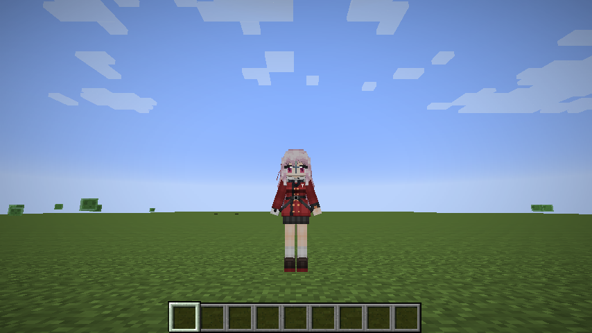
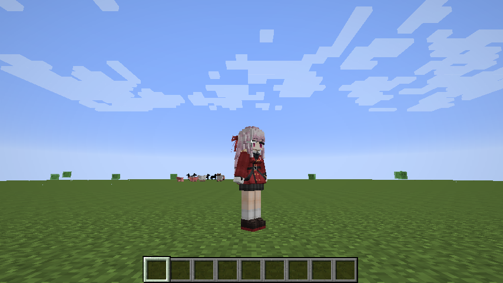
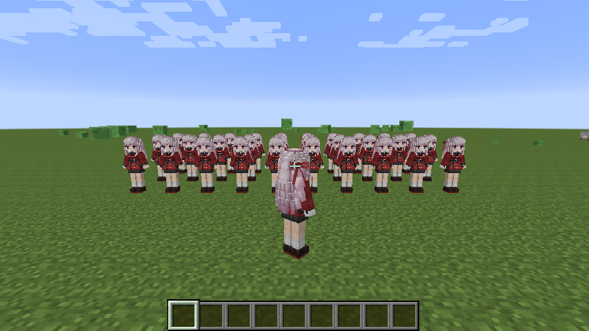

Harness (`dev/RenderHarness`, só com `./gradlew runClient -Pharness` e um arquivo `run/client/futura3d-harness`), em
**Mesa llvmpipe (renderização por software, na CPU)**, 854x480:

| Modelo | Cubos (quads) | Quadro sem cópias | +1 cópia | +10 cópias | +30 cópias |
|---|---|---|---|---|---|
| `default` | 172 (1032) | 23,4 ms | 30,2 ms | 37,4 ms | 39,9 ms |
| `wine_fox/18_wedding` | 1554 (6817) | 36,7 ms | 38,3 ms | 46,7 ms | 73,3 ms |
| `wine_fox/08_sta` | 4533 (26564) | 48,9 ms | 54,2 ms | 96,9 ms | 186,0 ms |

* Os números são de rasterização por software: servem para comparar entre si, não para prever uma placa de vídeo.
  O quadro "sem cópias" já inclui o próprio jogador com o modelo perto da câmera (preenchimento de tela).
  **A checar** numa máquina real e com Angelica.
* Na pose de repouso aparecem os adereços que as animações escondem (a espada gigante da Wedding, o tanque da Sta):
  eles têm escala 0 numa `pre_parallel`. O renderizador já pula ossos com escala 0, então com a fase 2 o custo real
  desses modelos cai.

## Molang

`molang/Molang.parse` compila uma vez (cache por texto, seguro entre threads) para uma árvore de nós; `evaluate` e
`evalNumber` rodam contra um `MolangContext` (funções do hospedeiro e `v.*`). Segue o `MolangSourceParser` do upstream:
mesmos tokens, precedências, apelidos (`q`→`query`, `c`→`context`, `v`/`variable`, `t`/`temp`, `r`/`roaming`),
`c ? a` sem `:`, `??`, `->`, blocos, `loop`, `for_each`, `break`/`continue`/`return`. Fail-soft: o que não compila
vira a constante 0; avaliar nunca lança. Testes: `src/test/java/com/akashic/futura/molang/`, incluindo um que compila
todos os textos Molang das animações e controladores embutidos.

Semântica do upstream que o interpretador reproduz (o motor dele, Semaweave, é binário; parte disto vem do bytecode e
das políticas em `ExpressionPolicy`, por isso **a checar** lado a lado com o YSM 1.20):

* números em float de 32 bits (`0.1 + 0.2 == 0.3` é verdadeiro); seno e cosseno em graus;
* valor ausente (variável nunca escrita, função desconhecida, número não finito do hospedeiro, `c ? a` falso) vale
  0 / `''`, mas `??` o distingue de 0, `false` e `''`;
* falha de execução zera o programa inteiro (as escritas anteriores ficam): resultado final não finito (`1/0`,
  `0/0`), argumento não finito passado a uma função, `math.sqrt(-1)`, `math.random_integer(a, a)`, mais de 10 000
  iterações de laço ou chamadas por avaliação. Exemplo nos modelos embutidos: `q.vertical_speed/math.abs(q.vertical_speed)`
  parado zera o canal inteiro (o YSM antigo dividia por 1);
* `math.random_integer` tem limite superior exclusivo; `math.clamp(v, lo, hi)` é `min(max(v, lo), hi)`;
* string não vazia é verdadeira e vale 1 (`'0'` também); `==` compara strings pelo conteúdo.

Fora: arrays (só existem como retorno de extensões Java no upstream; `for_each` e `a[i]` compilam e não fazem nada),
funções de usuário e `args`/`this` próprios (vão para o hospedeiro como namespace `fn`, `args`, `global`), a tipagem
estática do upstream (um programa com tipos incompatíveis lá é trocado por 0; aqui roda com as conversões numéricas).

## Fase 2 (animação): resultado no jogo

O cliente anima os jogadores: `client/PlayerInputsAdapter` preenche um `PlayerSnapshot` a partir do jogador da 1.7.10
a cada quadro, `client/PlayerModels` mantém um `PlayerAnimator` por jogador, e a pose vai para o `GeometryRenderer`.
O harness fotografa parado, andando, correndo, agachado e golpeando com espada (`default` e `wine_fox/18_wedding`):

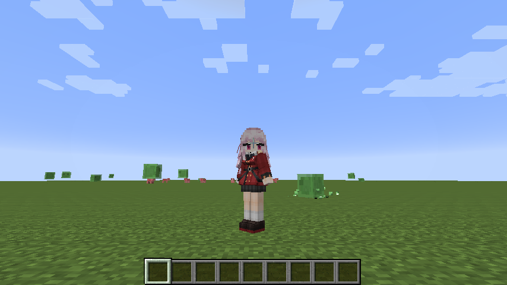
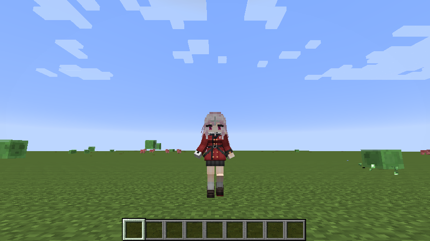
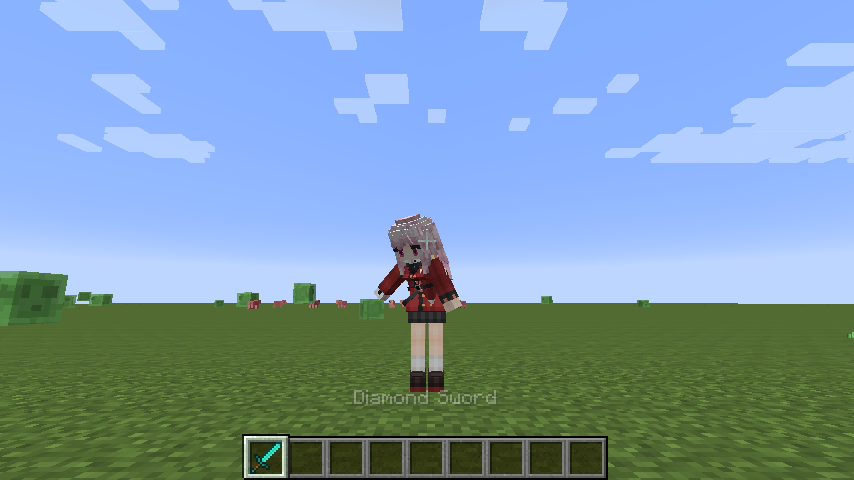

* Os adereços escondidos por `pre_parallel` (a espada gigante da Wedding) somem, a passada e o golpe animam.
* **A checar**: a direção do olhar da cabeça (no golpe a cabeça aparece inclinada; pode ser a animação ou o sinal do
  olhar), o agachar visto de lado, o piscar e a física de cabelo e saia em movimento (fotos paradas não mostram).
* Ainda não: itens nos locators (a espada não aparece na mão: fase 3), `ysm.bone_color`/`bone_transparency`/
  `bone_glow` no renderizador (`BoneAttributes` é calculado mas não aplicado), primeira pessoa, sono e a rotação de
  morte. Itens, atributos, sono e morte: feitos na fase 3a (abaixo).

## Fase 3a (terceira pessoa): resultado

Itens nos locators, atributos de osso, partições de face e os sinais visuais do jogo. Fotos do harness
(`dev/RenderHarness.itemSteps`, `futura3d-harness` com `items` roda só estes passos), cada uma ao lado do vanilla:

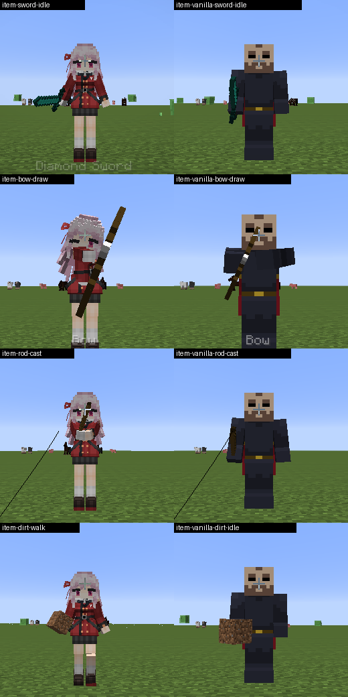
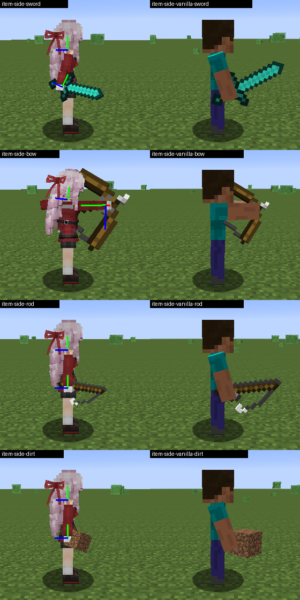
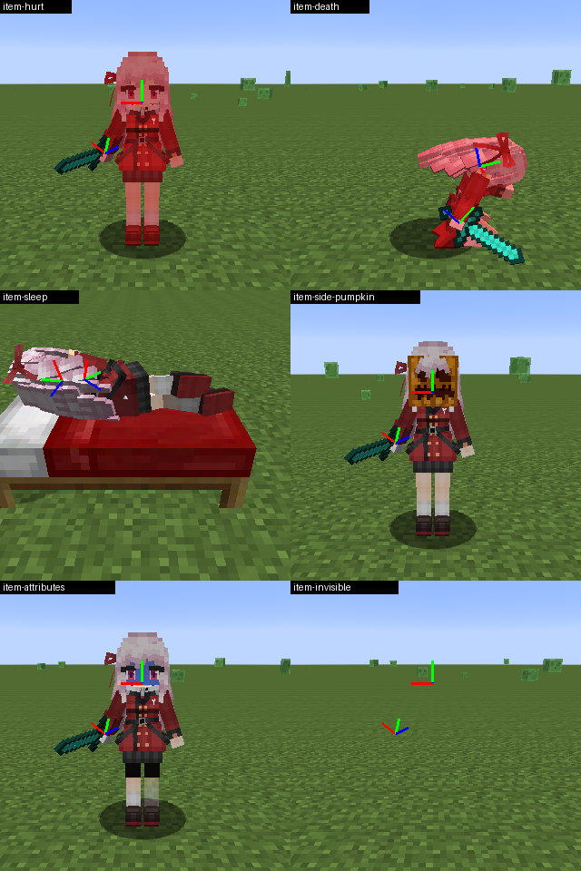

**Locators** (`geo/PoseMatrices`, puro e testado): a matriz de cada osso é calculada uma vez por quadro na CPU
(`T(pivô + posição) · Rz · Ry · Rx · S · T(-pivô)` encadeado) e serve às passadas de desenho e aos locators. O quadro de
um locator é a matriz do osso vezes `T(pivô)`, como `GeoModelState.visitLocatorGroup` do upstream; um grupo é todo osso
cujo nome sem os dígitos finais é o do grupo (`RightHandLocator`, `RightHandLocator2`...), e só ossos visíveis contam:
escala 0 num osso ou ancestral esconde o grupo, e o item com ele (o modelo `wine_fox/18_wedding` troca a espada da mão
pela própria, como o upstream decide em `attachments.md`).

**Itens** (`client/render/HeldItemRenderer`): o upstream põe o item em `locator · T(0, -1/16, -0.1) · Rx(-90°)` e chama o
`ItemInHandRenderer` da 1.20; o vanilla 1.20 usa `braço · Rx(-90°) · Ry(180°) · T(1/16, 0.125, -0.625)`. Igualando os
dois, o quadro de mão da 1.7.10 (`braço · T(-1/16, 7/16, 1/16)` de `RenderPlayer.renderEquippedItems`) fica
`locator · T(0, 1/8, 7/80) · Rz(180°)` (`geo/LocatorTransforms`, com teste), e dali seguem as transformações por item
da 1.7.10: blocos 3D, `IItemRenderer` `EQUIPPED` com `BLOCK_3D`, arco, ferramentas `isFull3D` (com a de bloquear),
itens planos, passadas múltiplas com cor, e a vara lançada desenhada como graveto, como o vanilla. Na pose de repouso
do modelo `default` a espada sai igual à do vanilla (conta feita em Python sobre a geometria); no jogo a pose de
segurar do modelo (`hold_mainhand:sword` gira o antebraço 30°) a deixa mais baixa e aberta, que é o que o modelo pede.
Capacete que não é armadura (bloco, abóbora, cabeça) vai no locator `Head`, como `CustomPlayerHeadLayer`; armadura não
é desenhada (o upstream também não). Os itens vêm depois do corpo, ou antes com `render_layers_first`.

**API para o Kunftig**: `PlayerModels.INSTANCE.locator(EntityPlayer, String)` devolve um `float[16]` (coluna principal,
ordem do `glMultMatrix`) do espaço local do locator (blocos, y para cima, origem no pivô animado, escala do modelo
incluída) para o espaço de render relativo à câmera (eixos do mundo, origem em `RenderManager.renderPosX/Y/Z`, o
espaço do `RenderWorldLastEvent`), ou `null` se o jogador não foi desenhado neste quadro nem no anterior ou o grupo
está escondido; `locators(...)` devolve o grupo inteiro. O quadro é guardado também para jogadores invisíveis, mas não
para o desenho no inventário. A mão esquerda: `PlayerModels.setOffhandSource(Function<EntityPlayer, ItemStack>)`, para
um mod como o Backhand dar o item, que vai no `LeftHandLocator` (a 1.7.10 vanilla não tem segunda mão).

**Partições** (`geo/FacePartition`, puro e testado, com os 24 modelos embutidos): a textura padrão é lida no
carregamento (`ImageIO`) e cada face é classificada pelo alfa sob o retângulo de UV: tudo 255 opaca, algum texel abaixo
de 255 (buracos inclusive) translúcida, tudo 0 fora. Corte de faces como o upstream decide: cubo completo (as seis faces
do arquivo) de tamanho positivo e todo opaco corta as costas; cubo completo de tamanho negativo sempre corta (o
enrolamento espelhado faz o corte esconder as faces da frente: a casca de contorno); o resto desenha os dois lados. Uma
display list por osso por partição. Opacas primeiro; as translúcidas em duas passadas, porque display list não ordena:
os texels totalmente opacos gravam profundidade, depois tudo é misturado com a máscara de profundidade desligada.
`all_cutout` trata toda face não vazia como opaca.

**Atributos de osso**: cor (vezes a do osso pai na chamada, não herdada), transparência só na partição translúcida
(`bone-opacity.md`), brilho 0..15 como luz de bloco e de céu (`-1` mantém a luz). Na foto: cabeça azul, alfa 80 em
todos os ossos (só o cabelo e um pedaço da perna somem), pernas com luz 0.

**Sinais**: o vermelho de dano e morte é a passada do `RendererLivingEntity` (modelo de novo, sem textura, onde a
profundidade foi gravada, cor `(brilho, 0, 0, 0,4)`). Invisível não desenha nada, nem itens, como o upstream (o vanilla
1.7.10 desenha o item na mão de um invisível). Na cama: o deslocamento de `RenderPlayer.renderLivingAt` e o giro de
`rotateCorpse` do vanilla, e a animação `sleep` deita o corpo (o upstream também mantém o giro da cama). Morte: sem a
inclinação do vanilla; o upstream zera `deathTime` antes de `setupRotations` e deixa a animação `death` fazer.

Desempenho no harness (llvmpipe, mesmas condições da fase 1, cópias na pose de repouso):

| Modelo | Quadro sem cópias | +1 | +10 | +30 |
|---|---|---|---|---|
| `default` | 25,9 ms | 32,6 ms | 41,1 ms | 46,6 ms |
| `wine_fox/18_wedding` | 25,1 ms | 35,8 ms | 56,5 ms | 98,7 ms |
| `wine_fox/08_sta` | 38,1 ms | 45,9 ms | 119,5 ms | 234,8 ms |

Entre 10 e 30% mais lento que a fase 2 nos modelos grandes com 10 e 30 cópias: faces que antes eram cortadas agora
têm os dois lados (como o upstream decide), as translúcidas passam duas vezes e há mais display lists. Trocar
`GL_NORMALIZE` por `GL_RESCALE_NORMAL` não mudou nada mensurável.

**A checar**:

* Em jogo, lado a lado com o YSM 1.20: a posição do item na mão (a conta das transformações é exata, mas as
  transformações por item da 1.7.10 não são as da 1.20), o bloco na cabeça (o upstream usa o contexto `HEAD` da 1.20)
  e a cabeça de jogador (`Items.skull`), que não foi fotografada.
* A segunda mão com o Backhand: o encaixe existe, mas o item usa a mesma transformação da mão direita, sem espelhar.
* ~~A linha da vara de pescar sai da mão do bíped vanilla (`RenderFish`), não do locator~~: feito na fase 3c.
* ~~Ordem de translúcidos entre si sem ordenação (o upstream ordena de trás para frente por desenho); `force_translucent`
  e o significado exato de `all_cutout` (o código nativo não está no repositório).~~: ordenados por quad e partições do nativo na etapa 6 (item 6).
* ~~As normais das faces de trás que ficam visíveis (casca de contorno, faces de dois lados) não são invertidas como o
  nativo faz: a luz delas pode sair mais escura.~~: iluminação de dois lados desde a etapa 6 (item 6).
* A animação `death` é de tocar uma vez: passado 1 s ela volta à pose de repouso; no jogo a entidade some aos 20 ticks,
  mas um mod que segure o jogador morto mais tempo veria isso.
* Desempenho com Angelica e numa placa de vídeo de verdade.

## Fase 2 (animação): runtime

Pacote `anim` (Java puro, testado). Ponto de entrada: `ModelAnimations.compile(loadedModel)` uma vez por modelo,
`new PlayerAnimator(anims)` uma vez por jogador, `update(inputs, ticksExisted + partialTicks)` a cada quadro e
`pose()` para o `GeometryRenderer`. As entradas vêm de `PlayerInputs` (cada getter diz o campo da 1.7.10;
`PlayerSnapshot` é uma implementação de campos simples).

| Upstream | Aqui |
|---|---|
| `geckolib3/core/keyframe/**`, `util/OrderedSegmentSearcher` | `Channel`, `Vec3Expr` |
| `format/parser/AnimationBuilder`, `model/resource/client/render/BakedAnimationMapper`, `RawBoneKeyFrame` | `ClipCompiler`, `AnimationClip` |
| `model/resource/client/AnimationStore`, `BakedAnimationSet`, `ExpressionSet` | `AnimationLibrary`, `DefaultAnimations` |
| `geckolib3/core/controller/AnimationPlayer`, `CodedAnimationController`, `transition/LinearBlendTransition` | `AnimationPlayer`, `CodedController`, `BoneQueue` |
| `geckolib3/core/processor/AnimationProcessor`, `snapshot/**`, `keyframe/AnimationVec3`, `util/MathUtil` | `AnimationProcessor`, `AnimMath` |
| `client/controller/collections/PlayerControllerCollection`, `client/animation/predicate/**` | `PlayerControllers` |
| `client/animation/AnimationRegister`, `PlayerMainPredicate` | `MainStates` |
| `client/animation/condition/**` | `ItemConditions` |
| `client/animation/physics/**` | `anim/physics` |
| `expression/host/builtin/{Entity,Model,ControlRead,Control,Player}Builtins`, `PositionComponent` | `PlayerMolangContext` |
| `format/schema/model/ModelOriginVersion` | `OriginVersion` |
| `client/entity/{Animatable,CustomHumanoid,CustomPlayer}Entity` (fluxo do quadro, olhar, emotes) | `PlayerAnimator` |

Igual ao upstream: amostragem (pre/post, linear, Catmull-Rom com a regra do Blockbench, segmento 0 segurando o `pre`
do primeiro quadro-chave), unidades (rotação em radianos com x e y negados, posição em pixels convertida para blocos com
x negado na pose, escalar para os três eixos), loop/uma vez/segurar no fim, transição de entrada por controlador (0,1 s
em main/hold/use/vehicle/passenger, 0 nos outros; escala sem transição de entrada nos controladores codificados),
transição de saída de 3 ticks (instantânea em ossos cuja animação tem escala), volta ao repouso em 3 ticks com nlerp de
quatérnio na rotação, `parallel*` somando rotação, `blend_weight`, mesma animação sem reinício, ordem dos controladores,
tabela de estados `main`, `$id`/`#tag`/`:classe`/ação de uso, `vehicle$`/`passenger$`, armadura `<slot>$`/`<slot>#`/
`<slot>:default`, regra de loop das mãos por `origin_ver`, fallback do modelo padrão (inclusive os `parallel*` e
`pre_parallel*` dele em modelos que não os têm), física `second_order`/`first_order` com o mesmo passo, olhar da cabeça
aplicado por código nos ossos `Head`/`HeadN` (2.x), piscar de `ysm.is_close_eyes`, `ctrl.*` e `query.*`.

Diferente, de propósito:

* `query.anim_time` vale o tempo da animação amostrada. No 2.x o contexto da animação é encerrado antes de o
  processador avaliar os quadros-chave, o que deixaria `anim_time` em 0 (modelos embutidos usam `q.anim_time` em
  quadros-chave). **A checar** contra o YSM 1.20 em jogo.
* Nomes `#tag` que não são resource locations válidos (nomes do OreDictionary, `ingotIron`) são aceitos como escritos;
  o upstream os descarta. Nomes de animação são lidos em ordem alfabética (a ordem das tags fica determinística).
* `second_order` com f = 0 e `first_order` com R = 0 não dividem por zero (o upstream fica congelado ou dá NaN).
  Valores não finitos de expressões viram 0 na pose.
* Um tempo de quadro que volta para trás (entidade nova) só re-ancora o relógio.
* Os efeitos `ysm.bone_color/transparency/glow` vão direto para `BoneAttributes` (sem lote de efeitos nem a
  distinção CONTEXT/ACTION); o `GeometryRenderer` os aplica desde a fase 3a.

Fora por enquanto: controladores Bedrock dos arquivos e os `pre_main`/`post_main`/`pre_hold`... que só existem quando
declarados (encaixe em `PlayerControllers`/`AnimationController`, fase 5), as funções `player_ctrl_*` que sobrepõem um
controlador codificado, sons de quadro-chave e `ysm.play_sound`, partículas, `ysm.sync`/`defer`, limitador de FPS da
animação, primeira pessoa (`fp_arm`, feita na fase 3b), compatibilidades de mods (ParCool, TaCZ, SlashBlade, Carry
On...). Testes: 72.

## Fase 3b: primeira pessoa e animações extras (emotes)

### Braços em primeira pessoa

| Upstream | Aqui |
|---|---|
| `client/controller/collections/FPArmControllerCollection`, `client/animation/predicate/FPArmArmorPredicate` | `anim/FirstPersonControllers` |
| `client/entity/CustomFirstPersonArmEntity` (animador próprio, `v.roaming` projetado do corpo) | `PlayerAnimator.firstPerson`, `MolangVariables(MolangVariables)` |
| `client/entity/FirstPersonModelState` (raízes `LeftArm`/`RightArm`/`Background`, subárvore sem os ancestrais) | `ModelAnimations.compileFirstPerson`, `GeometryRenderer.drawSubtree` |
| `client/renderer/CustomFirstPersonArmRenderer`, `client/event/ReplacePlayerHandRenderEvent`, `RenderFirstPlayerBackground` | `client/FirstPersonArms`, `mixin/mixins/RenderPlayerArmMixin`, `ItemRendererMixin` |

O braço em primeira pessoa é a geometria `arm` do modelo com um segundo `PlayerAnimator` do mesmo jogador, só com
os controladores do upstream para os braços: `fp.arm.parallel_N` (os `parallelN` do conjunto `fp_arm`, somando
rotação, com o `fp_arm` do modelo padrão por trás) e `fp.arm.armor_<slot>`. Não há main, hold, use nem swing nos
braços: o conjunto `arm` do modelo, apesar do nome, tem as animações de mão da terceira pessoa (ossos `UpBody`,
`Head`...), e o upstream não o usa na primeira pessoa. O braço se move com as transformações da própria 1.7.10
(balanço da câmera, `equippedProgress`, golpe). As variáveis `v.roaming.*` do braço são as do corpo; as outras são
dele.

No jogo, `RenderPlayer.renderFirstPersonArm` (que a 1.7.10 chama com a mão vazia e, duas vezes, com um mapa) é
trocado pela subárvore `RightArm`, na mesma matriz e com o mesmo deslocamento do upstream (`translate(-0,25, 1,8, 0)`,
`scale(-1, -1, 1)`). A 1.7.10 só desenha o braço direito, então `LeftArm` não aparece (no mapa os dois braços são o
direito, como na vanilla). Itens na mão ficam onde a vanilla os põe, como no upstream (que também só troca o braço sem
item). O osso `Background`, quando existe, é desenhado na pose de repouso depois do balanço do braço, com o balanço da
câmera desfeito e 1,5 bloco abaixo, como `RenderFirstPlayerBackground`; nenhum modelo embutido tem esse osso.

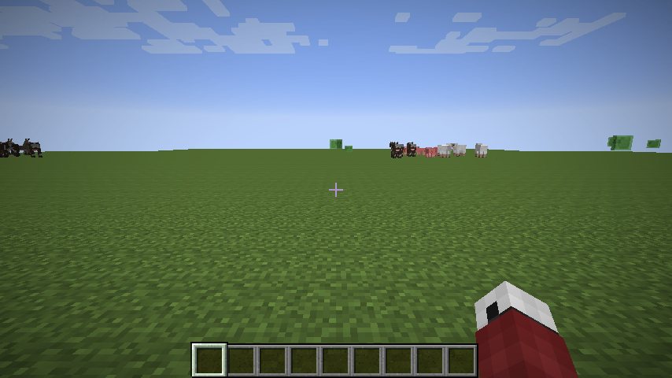
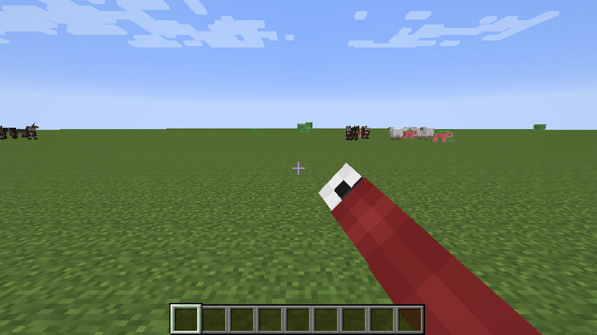

Harness (`firstPersonSteps`): parado, vanilla, andando, golpe com a mão vazia, golpe vanilla, espada (a vanilla
desenha só o item), `wine_fox/19_nine_tailed` (o `parallel0` dele anima ossos do braço). O braço do modelo fica no
lugar do vanilla, um pouco mais fino (é a geometria do modelo) e acompanha o golpe e o balanço de andar.

* **A checar** em jogo: o `Background` (sem modelo embutido para testar; o desfazer do balanço usa os campos da 1.7.10
  e não inclui o `cameraPitch`), o braço no mapa, a luz do braço sob o sol e no escuro, Angelica.
* ~~A câmera não se move: no upstream, `ViewLocator` e `AllHead` só servem à compatibilidade com o mod First Person
  Model (corpo visível em primeira pessoa e altura dos olhos). Na 1.7.10 a câmera fica na altura vanilla.~~: a câmera passa a seguir o `ViewLocator`/`Head` na etapa 6 (item 4).
* Fase 5: o `fp.arm.misc` e os `fp.arm.parallel_*` declarados em arquivos de controladores do braço (o upstream só os
  cria quando o modelo os declara; entram primeiro na lista de `FirstPersonControllers`).

### Animações extras (emotes)

| Upstream | Aqui |
|---|---|
| `client/gui/AnimationRouletteScreen` (estado: caminho, páginas, cliques) | `emote/RouletteMenu` (sem Minecraft, testado) |
| `client/gui/AnimationRouletteScreen` (desenho), `button/FlatColorButton` | `client/gui/AnimationRouletteScreen` |
| `client/input/AnimationRouletteKey`, `ExtraAnimationKey`, `client/event/PlayerMoveEvent` | `client/EmoteKeys` |
| `ClientProtocolGateway.playSelfAnimation`/`stopSelfAnimation` | `client/LocalEmotes`, `emote/EmoteListener` |

Teclas (categoria "3D Futura Engine"): roleta em `Z` (como no upstream e no YSM antigo), animações extras 0 a 7 sem
tecla, trava da roleta sem tecla (no upstream é Alt+L; a 1.7.10 não tem modificadores). A roleta mostra as entradas de
`properties.extra_animation` (chave = animação, valor = rótulo; valor em branco mostra o índice), oito por página,
as subpáginas `#id` de `extra_animation_classify` em vermelho, `#return` volta um nível (fecha na raiz), no máximo
6 níveis no caminho, e a página aberta é lembrada por modelo. As teclas extras 0-7 endereçam as entradas da raiz
(`#return` para o emote, `#id` abre a roleta na subpágina) e não tocam nada com o jogador andando. Andar, pular ou
agachar para o emote, a não ser com a trava ligada (botão no centro da roleta ou a tecla).

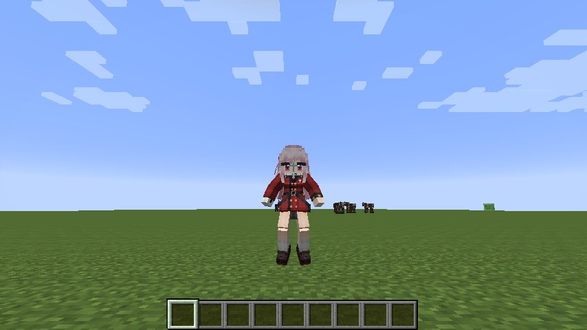
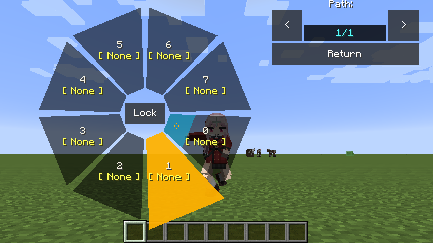

Seam para a rede (fase 4): os emotes por enquanto são só locais. `LocalEmotes.play`/`stop` tocam no animador do
jogador local e avisam os `EmoteListener` registrados com `LocalEmotes.addListener`; a camada de rede registra um que
manda o pedido ao servidor, e cada cliente que recebe o repasse chama
`PlayerModels.INSTANCE.animator(player).playExtra(name)`/`stopExtra()` para aquele jogador.

Ainda não:

* ~~`extra_animation_buttons` com `config_forms`: o painel só lista os formulários~~: editáveis desde a fase 5b.
* ~~Os rótulos e descrições traduzidos dos arquivos `lang` do modelo (`properties.extra_animation.<chave>`) e a dica com
  a descrição: aparece o texto do `ysm.json`.~~: feitos na etapa 6 (item 5).
* ~~Mensagem no chat ao tocar (opção `PRINT_ANIMATION_ROULETTE_MSG`).~~: `print_animation_roulette_msg`, etapa 6.
* **A checar** em jogo: a roleta com outras escalas de interface, roda do mouse, modelos com várias páginas e
  subpáginas (`wine_fox/08_sta`).

Testes: 182 (31 do braço em primeira pessoa, incluindo todos os modelos embutidos; 6 da roleta; 2 do `v.roaming`
compartilhado).

## Fase 3c: API para outros mods, linha de pesca, varas e lâminas do Kunftig

### API estável (`api/FuturaModels`)

`com.akashic.futura.api.FuturaModels` é o ponto de entrada para outros mods, só com tipos do JDK e do Minecraft nas
assinaturas, para ser chamado por reflexão (o Kunftig não depende do futura3d). Lado do cliente; no servidor dedicado
responde `false`/`null`. `API_VERSION = 2` (o 2, da fase 4b, acrescenta `modelKey`).

| Método | O que dá |
|---|---|
| `isModelled(player)` | desenhado no mundo com modelo neste quadro ou no anterior |
| `modelKey(player)` | o modelo com que o jogador é desenhado agora (`builtin:<pasta>` ou `server:<id>`; `builtin:default` enquanto o dele carrega). Cada jogador tem o seu, então os locators diferem de um para outro |
| `locator(player, nome)`, `locatorOrNull(player, nomes...)`, `locators(player, nome)` | quadro do locator em espaço de render relativo à câmera (o de `RenderWorldLastEvent`); pedido antes de o jogador ser desenhado neste quadro (uma entidade desenhada antes, como a boia), a pose do quadro anterior é levada junto com o jogador para onde ele está agora |
| `hasLocator(player, nome)` | o modelo tem um osso do grupo, visível ou escondido (escala 0) |
| `drewModel(player)`, `locatorInLastDraw(player, nome)` | para quem trata `RenderPlayerEvent.Post`: se o desenho que acabou foi o modelo, e o locator relativo à matriz desse evento (mundo ou inventário). `RenderPlayerEvent.Specials` não dispara para jogador com modelo |
| `setKeepsItemWhileFishing(Predicate)` | um mod que desenha a própria vara (o Kunftig) mantém o item na mão com a linha fora, no lugar do graveto |
| `fishingPhase(player)`, `FISHING_STATE`, `FISHING_TENSION` (API 4) | a vara nos modelos: a fase que o modelo toca e os estados que o Kunftig diz (ver "Pesca", abaixo) |
| `setArmPose(player, direito, esquerdo)` (API 5) | os braços do modelo por um instante, como um mod põe os do bíped (os peixes 3D do Kunftig; ver "Varas e peixes 3D", abaixo) |

### Linha de pesca

`mixin/mixins/RenderFishMixin` + `client/FishingLine`: com o pescador desenhado com modelo (e fora da primeira pessoa
dele mesmo), a linha vanilla sai da ponta do graveto que o modelo segura no `RightHandLocator`
(`LocatorTransforms.castRodTip`: o fim do ícone do graveto pelas transformações da 1.7.10, 0,77 bloco à frente da mão
e 0,17 acima, com teste). Só os `addVertex` da linha são redirecionados (a curva é a vanilla); o `startDrawing` fica
livre, e é nele que o `RenderFishLineMixin` do Kunftig cancela o desenho para pôr a linha na ponta da vara 3D. Assim
os dois compõem em qualquer ordem de aplicação dos mixins: com vara 3D e ponta capturada, a linha do Kunftig; senão, a
linha vanilla saindo do modelo.

O upstream **não** faz isso: `FishingHookRendererReplace` mantém os deslocamentos fixos do vanilla (só soma o
agachar) e a linha não segue a mão do modelo. Aqui segue, porque na 1.7.10 esses deslocamentos ficam longe da mão.

### Resultado (harness do Kunftig, modo `models`, com o jar de dev do futura3d em `run/client/mods`)

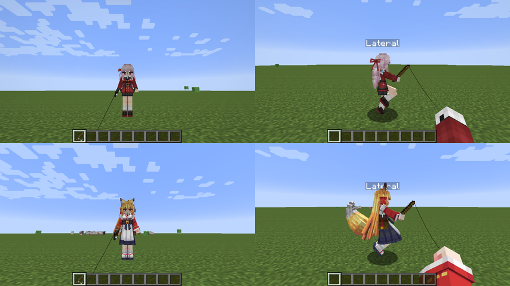

* Vara vanilla lançada: graveto na mão do modelo e a linha saindo da ponta dele, de frente e de lado, nos modelos
  `default` e `wine_fox/13_matured`.
* Vara 3D do Kunftig (pack do AkashicFishing): desenhada na mão do modelo pelo `IItemRenderer` `EQUIPPED`, continua
  na mão com a linha fora (o `Predicate` acima), e a linha dourada sai da ponta capturada pelo Kunftig.
* Lâmina do Kunftig (estilo SlashBlade) nos locators `BladeLocator`/`SheathLocator`/`LeftWaistLocator`: ver o Kunftig,
  `docs/playermodel/ESTUDO-YSM.md`, seção 10.
* `isModelled` falso em primeira pessoa do jogador local, verdadeiro em terceira e para outro jogador.

**A checar**: em jogo de verdade (não no harness) a linha de outro jogador num servidor, com a boia desenhada antes
dele (o caminho do quadro anterior); a linha com o jogador dormindo ou montado; a cor da linha (vanilla preta).

Testes: 226.

## Fase 4a: servidor, protocolo e transferência de modelos

O servidor (dedicado, ou o integrado do singleplayer, pelo mesmo caminho) lê modelos abertos de
`config/futura3d/models/`, manda o catálogo a quem tem o mod, transfere os arquivos que o cliente não tem no cache,
guarda o modelo e a textura de cada jogador por UUID e repassa emotes. Cliente vanilla não recebe nada; cliente com o
mod num servidor sem ele manda um hello que ninguém responde e fica só com as escolhas locais.

### Canal

Um canal FML orientado a eventos, `futura3d:model` (14 caracteres; o limite do Bukkit 1.7 é 16), em `ModNetwork`.
Por que FML e não `S3FPacketCustomPayload`/`C17PacketCustomPayload` crus: o `NetworkDispatcher` do FML fica no
pipeline netty da conexão no Forge, no Thermos e no Crucible, e entrega os pacotes de canais registrados ao mod antes do
handler vanilla (que o Thermos reescreve para alimentar o plugin messaging do Bukkit), nos dois sentidos; o C17 cru
precisaria de um gancho em `NetHandlerPlayServer.processVanilla250Packet`, justamente o método que o Thermos troca. Um
`FMLProxyPacket` não tem prioridade, então vai para a fila da `NetworkManager` e é tratado na thread principal (do
servidor ou do cliente): nada de travas.

O cliente só fala depois de entrar no mundo (primeiro tick com `getNetHandler()`), com um hello; o servidor só manda
algo a quem mandou hello com a mesma versão. Servidor sem o mod ignora o canal desconhecido (vanilla, Forge e o
Messenger do Bukkit fazem isso).

### Protocolo (`net/`, Java puro, testado)

Cada payload: byte de tipo, depois os campos em `DataOutput` (big endian); string = tamanho em bytes (u16) + UTF-8
estrito; string anulável = byte 0/1 + string; hash = 32 bytes crus; UUID = dois longs. Nunca serialização Java, nunca
Molang ou código para executar (os arquivos do modelo são dados, lidos pelo carregador de sempre).

| Tipo | Sentido | Campos |
|---|---|---|
| 1 `S_HELLO` | S→C | versão, revisão do catálogo, nº de modelos, UUID do jogador no servidor |
| 2 `S_MODEL` | S→C | revisão, id, nome, dica, licença, autores, flags (restrito, bloqueado para este jogador), arquivos (caminho, tamanho, sha256) |
| 3 `S_CATALOG_END` | S→C | revisão: o catálogo novo substitui o anterior |
| 4 `S_CHUNK` | S→C | hash, tamanho total, offset, dados (≤ 30 656 bytes, payload < 30 KiB) |
| 5 `S_UNAVAILABLE` | S→C | hash que o servidor não tem mais |
| 6 `S_STATE` | S→C | até 96 × (UUID, chave ou nulo, textura ou nulo) |
| 7 `S_EMOTE` | S→C | UUID, animação ou nulo (parar) |
| 64 `C_HELLO` | C→S | versão |
| 65 `C_REQUEST` | C→S | 1 a 256 hashes |
| 66 `C_SELECT` | C→S | chave ou nulo, textura ou nulo, `initial` (a escolha local gravada, mandada ao entrar) |
| 67 `C_EMOTE` | C→S | animação ou nulo |

* Versão `Protocol.VERSION = 1`. Os dois hellos começam sempre com tipo + versão: uma versão futura reconhece a
  diferença. Versões diferentes: o servidor responde só com o próprio hello e o cliente fica com o local.
* Chaves: `builtin:<pasta>` (o cliente tem; nunca é transferido) e `server:<id>` (64 hex). Id do modelo = SHA-256 da
  lista canônica de arquivos (caminho UTF-8, byte 0, tamanho, hash, em ordem de caminho): dois servidores com os mesmos
  arquivos dão o mesmo id, e o cliente confere o id contra a lista.
* O hello traz o UUID do jogador no servidor: num servidor em modo offline (comum com Thermos) ele é diferente do UUID
  da sessão do cliente, e o cliente traduz estados e emotes desse UUID para o jogador local. Achado no teste com o
  servidor dedicado: sem isso o próprio jogador nunca trocava de modelo.
* `C_SELECT` com `initial`: o cliente manda `ModelSelection.localKey()`/`localTexture()` ao entrar; o servidor só usa
  se não tem nada gravado para o jogador (nem a escolha dele, nem a de um operador).

Limites conferidos na decodificação, antes de alocar: payload ≤ 32 767 bytes e nada sobrando no fim, tipo conhecido e
do lado certo, ≤ 1024 modelos, ≤ 512 arquivos por modelo, caminho ≤ 256 bytes, limpo (`ModelSource.clean` não muda
nada, sem `..`, `//`, `\`, `/` no início ou fim) e sem repetição, `ysm.json` presente, arquivo ≤ 16 MiB, modelo ≤ 64 MiB,
catálogo ≤ 1 GiB baixado, nome ≤ 256 bytes, dica ≤ 2048, licença ≤ 128, ≤ 16 autores de ≤ 128, chave ≤ 128 e com forma
válida, textura e animação ≤ 128 sem caracteres de controle, chunk dentro do arquivo. Depois de 32 erros de protocolo de
um lado, as mensagens dele passam a ser ignoradas.

### Repositório do servidor (`server/ModelRepository`)

`config/futura3d/models/<nome>/` ou `<nome>.zip` (qualquer um seleciona) e `config/futura3d/models/auth/...`
(restritos: precisa de permissão). Formato aberto, `ysm.json` spec 2; um zip com tudo dentro de uma pasta é lido dessa
pasta. Qualquer outra coisa é pulada com uma linha no log, `.ysm` inclusive ("encrypted .ysm exports are not
supported"); nomes com espaço, nomes repetidos e modelos com os mesmos arquivos de outro também.

Cada modelo é lido para a memória com limites (`net/ModelLimits`, configuráveis em `config/futura3d/server.properties`):
só arquivos `json png jpg jpeg webp avif ogg molang lang txt` (o resto, como `.bbmodel`, fica fora), ocultos e
`__MACOSX` fora, links simbólicos não seguidos, profundidade 16, ≤ 512 arquivos, ≤ 16 MiB por arquivo contando o que é
lido de verdade (bomba de zip para no limite), ≤ 32 MiB por modelo, ≤ 4096 entradas de zip olhadas, entrada de zip que
sai do modelo recusa o modelo (`ModelSource.clean`); PNG e JPEG ≤ 4096 px de lado pelo cabeçalho, sem decodificar; JSON
percorrido em streaming (profundidade ≤ 64, strings ≤ 64 Ki caracteres, onde moram as expressões Molang, ≤ 4 M tokens)
antes do Gson; texto (`.molang`) ≤ 256 KiB. Depois o modelo é carregado de verdade com `model/ModelLoader` e conferido:
≤ 4096 ossos, ≤ 32 768 cubos, ≤ 4096 animações. A entrada do catálogo tem de caber numa mensagem (< 30 KiB).
Memória total ≤ 512 MiB. Os 24 modelos embutidos passam nos limites padrão (teste).

`/futura3d reload` relê numa thread própria; o tick seguinte troca os modelos, limpa as filas de envio, manda o
catálogo novo a todos e reenvia os estados (o id muda quando os arquivos mudam; a escolha gravada segue o modelo pelo
nome).

### Seleção, permissões e comandos

`config/futura3d/players/<uuid>.json` (escrito num temporário e movido no lugar; arquivo ilegível vira `.bad`):
`builtin` ou `model` (nome), `texture`, `forced`, `grants`. Restaurado ao entrar e mandado a todos com o mod (o estado
de todo jogador online vai para todo cliente com o mod, não só para quem o rastreia: assim quem chega perto já sabe).
Textura que o modelo não tem vira a padrão. Escolha inválida do cliente: o servidor devolve só a ele o estado atual.

A permissão está em `ModelServer.canUse`/`canUseBuiltin`. Desde a Etapa 6 (seção "Permissões por modelo" abaixo),
com `requirePermission=true` (padrão) todo modelo precisa do nó `futura3d.playermodel.<modelo>`, de um grant ou de
estar em `freeModels`; com `false`, só os restritos precisam (o comportamento desta fase).

| Comando (nível 2) | O que faz |
|---|---|
| `/futura3d list` | modelos, arquivos, bytes, id, texturas; `[auth]` nos restritos |
| `/futura3d reload` | relê os modelos sem reiniciar |
| `/futura3d set <jogador> <modelo\|default\|builtin:<pasta>> [textura]` | escolha do operador, vale mesmo restrito sem grant; jogador offline por nome ou UUID |
| `/futura3d auth <jogador> add\|remove <modelo>` | grant; reenvia o catálogo (o `locked` muda) |
| `/futura3d access <jogador>` | o que ele pode escolher, e o nó de cada modelo (Etapa 6) |
| `/futura3d play <jogador> <animação\|stop>` | emote para quem o vê e para ele |

Modelo por nome da pasta/zip ou pelo começo do id (≥ 8 hex). Taxa por jogador: 1 seleção/s (rajada 4), 2 emotes/s
(rajada 6).

### Transferência e cache do cliente

O servidor manda o catálogo inteiro a cada jogador (modelos bloqueados também: ele precisa desenhá-los nos outros), com
o `locked` dele. O cliente (`net/ClientSession`, puro) pede só os hashes que não estão em
`<mcDataDir>/futura3d/cache/<sha256>` (`net/DiskFileCache`: grava num temporário e move, confere o hash a cada
leitura e apaga o arquivo corrompido), no máximo 16 arquivos ou 8 MiB pendentes por vez. O servidor (`TransferQueue`)
manda os pedidos em ordem, em pedaços desde o offset 0, com balde de fichas por jogador (`bytesPerSecondPerPlayer`,
padrão 512 KiB/s). O cliente remonta com o tamanho do catálogo, recusa pedaço fora de ordem, confere o SHA-256, grava,
e quando todos os arquivos de um modelo estão lá confere os arquivos de novo por tipo (`ModelLimits.checkFiles`, numa
thread própria) e registra `ModelRegistry.registerServerModel("server:" + id, new CachedModelSource(...), locked)`
(`net/CachedModelSource`, que lê do cache conferindo o hash). Catálogo novo: `clearServerModels()` e os modelos voltam
do cache. Ao sair: `setHandler(null)`, `clearServerModels()`, `clearRemote()`, ouvinte de emotes removido.

Estados chegam em `ModelSelection.select`; enquanto o servidor tem o mod, o handler manda a escolha do seletor ao
servidor (que valida e devolve o estado). Emotes: o `EmoteListener` manda play/stop; o servidor repassa a quem rastreia
o jogador; o cliente chama `PlayerModels.animator(jogador).playExtra/stopExtra`.

| Arquivo | |
|---|---|
| `ModNetwork` | canal FML, pacote ↔ bytes |
| `net/Protocol`, `Message`, `MessageCodec`, `Sha256`, `FileRef`, `CatalogEntry` | protocolo |
| `net/ClientSession`, `FileCache`, `DiskFileCache`, `CachedModelSource`, `ModelLimits` | lado do cliente sem Minecraft, limites comuns |
| `server/ModelRepository`, `ServerModel`, `PlayerStore`, `TransferQueue`, `BuiltinModels`, `ModelServer` | lado do servidor sem Minecraft |
| `server/ForgeModelServer`, `FuturaCommand` | cola com o Forge (só classes comuns: o dedicado carrega) |
| `client/net/ClientNetwork` | cola do cliente |
| `dev/ConnectHarness` | harness: `connect <host>:<porta> [modelo]` em `run/client/futura3d-harness` entra num servidor dedicado |

### Resultado

Servidor dedicado (`./gradlew runServer`, Java 8, modo offline, `config/futura3d/models/futura_test` = cópia do
embutido CC0 `misc/1_alex`, `auth/steve` = cópia de `misc/2_steve`, e um `encrypted.ysm` falso) e um cliente
(`runClient -Pharness`, modo `connect`), pelo caminho de rede de verdade (o singleplayer passa os pacotes como objetos,
sem serializar):

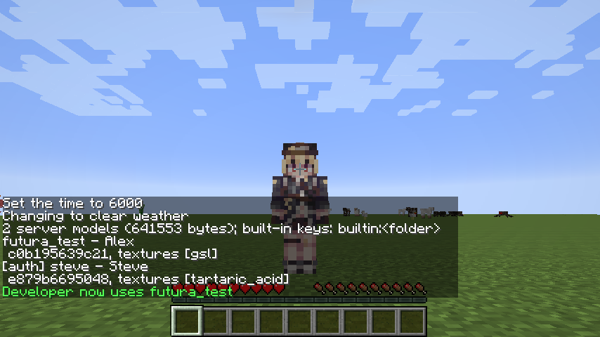
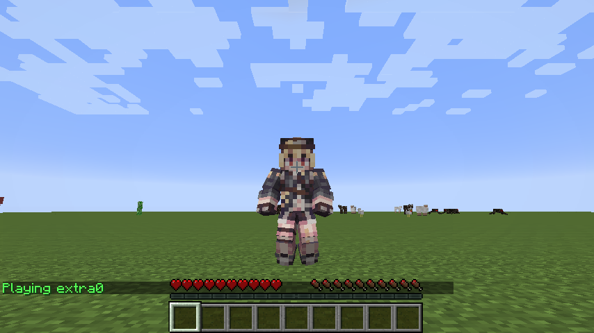

* Log do servidor: `Skipped encrypted.ysm: encrypted .ysm exports are not supported`, `Loaded futura_test: Alex (...,
  11 files, 326123 bytes)`, `Loaded auth/steve`.
* Cliente com cache vazio: catálogo de 2 modelos, 641 553 bytes baixados em 1 a 2 s (o limite padrão é 512 KiB/s), 19 arquivos
  no cache (os avatares repetidos entre os dois modelos vão uma vez só), os dois modelos registrados e carregados pelo
  `ModelRegistry`. `/futura3d set` → a chave do jogador local vira `server:c0b19563...` e ele aparece com o modelo;
  `/futura3d play ... extra0` → `isPlayingExtra()` verdadeiro, `stop` → falso; `auth add/remove` e `reload` reenviam
  o catálogo e os modelos voltam do cache sem baixar de novo.
* `./gradlew runServer21` (Java 21.0.11 com lwjgl3ify e Hodgepodge): o dedicado sobe, lê os modelos e não carrega
  classe de cliente. O cliente de dev não entra nele (o servidor exige o gtnhlib que o cliente não tem), então o
  caminho de rede foi testado com o servidor Java 8.
* Singleplayer (harness, `only server`): os passos `server-*` trocam o jogador para o modelo do servidor integrado
  pelo mesmo caminho.
* Uma das conexões do cliente de dev ao dedicado ficou parada em "Connecting" sem rastro no servidor; repetida, entrou.

**A checar**:

* ~~Num Thermos/Crucible de verdade com Java 21: o canal FML convivendo com plugins Bukkit, o modo offline~~: feito
  no teste do TEOF 5.3 (abaixo); o modo online segue a checar.
* ~~Vários jogadores ao mesmo tempo: troca de modelo e emote de outro jogador vistos ao vivo~~: feito no teste do
  TEOF 5.3, com dois clientes. ~~Quem chega perto no meio de um emote não o vê~~: resolvido na fase 5b (o emote vai
  no `StartTracking`).
* Links lentos e muitos jogadores baixando juntos: não há limite global, só por jogador; os pedaços disputam a conexão
  com os pacotes do jogo.
* Cliente vanilla e cliente com o mod em servidor sem o mod (pelo código, nada é mandado a quem não manda hello e o
  hello cai num canal desconhecido; não testado com um cliente vanilla de verdade).
* Pastas de modelos grandes: a leitura do início é síncrona (o reload não); um servidor com centenas de modelos atrasa
  a partida. O cache do cliente não tem limite de tamanho nem limpeza.
* A escolha pelo seletor no jogo indo ao servidor por clique: o caminho do botão (`requestLocal` → `C_SELECT`) foi
  visto no teste do TEOF 5.3, com o outro jogador vendo a troca; o clique de mouse em si segue a checar.

Testes: 313 (60 desta fase: codec e limites, sessão do cliente, cache em disco, limites com os 24 embutidos,
repositório com pastas, zips, zip slip, bomba de zip e links, gravação por UUID, fila com limite de taxa e o servidor
falando com sessões de cliente reais pelo codec).

## Fase 4b: vários modelos no cliente e o seletor

Cada jogador é desenhado com o seu modelo. A camada de rede (fase 4a, outro trabalho: pacotes `net` e `server`) só
fala com dois contratos do cliente, `client/ModelRegistry` e `client/ModelSelection`; esta fase os implementa, junto
com o desenho por jogador, as fontes de modelo, as texturas que não estão nos pacotes de recursos e o seletor.

### Modelos conhecidos (`ModelRegistry`)

* Chaves `builtin:<pasta>` para cada modelo embutido e `server:<id>` para os que o servidor mandar. Os embutidos são
  listados em `assets/futura3d/builtin/index.txt` (um jar não se lista de forma portátil; `ModelInfoTest` confere que
  o índice tem todas as pastas com `ysm.json`), na ordem do seletor: `default`, `misc/*`, `wine_fox/*`.
* No início só os manifestos são lidos (`model/ModelInfo`: nome, autores, licença, texturas, `preview_animation`);
  `builtin:default`, o modelo de reserva, é carregado na hora. Os outros carregam no primeiro uso (alguém o escolhe, o
  seletor o mostra) num executor de duas threads de baixa prioridade: leitura, `GeoBaker`, compilação das animações
  (terceira e primeira pessoa), decodificação das texturas e partições de face. O trabalho de GL (display lists,
  envio da textura) fica para o primeiro desenho, na thread de render (`client/ClientModel`).
* `registerServerModel(chave, fonte, travado)` carrega fora da thread de render e substitui a chave (o modelo antigo
  continua desenhado até o novo ficar pronto, e então é liberado). Enquanto um modelo não está pronto, quem o escolheu
  aparece com `builtin:default`.
* Memória: `clearServerModels()` libera display lists e texturas dos modelos do servidor e esquece os animadores e
  quadros deles; ao fechar o seletor, os embutidos que ele carregou e que ninguém usa nem escolheu são liberados
  (`releaseUnused`) e carregam de novo quando preciso.

### Seleção (`ModelSelection`)

`select(uuid, chave, textura)`, `keyOf`, `textureOf`, `clearRemote()` e `setHandler`, como o contrato. Sem handler
(um jogador, ou servidor sem o mod), `requestLocal` aplica a escolha ao jogador local e a grava em
**`config/futura3d-client.properties`** (`model=` e `texture=`; `requestLocal(null, null)` apaga o arquivo), que
volta depois de reiniciar o jogo; uma seleção que o servidor mande para o jogador local vale mais que ela. Com
handler, `requestLocal` só chama o handler. `localKey()`/`localTexture()` dão a escolha gravada para a rede mandar ao
entrar num servidor.

### Desenho por jogador

`PlayerModels` pede a `ModelSelection` a chave de cada jogador (`builtin:default` quando nula ou não pronta), escolhe a
textura (`texture` = nome do arquivo sem extensão entre as do modelo, senão a padrão do modelo) e mantém um
`PlayerAnimator` por jogador **e modelo**: quando o modelo do jogador muda, o animador antigo é descartado. Os quadros
dos locators (`ThirdPersonRenderer`) também são por jogador e trocados quando a geometria muda, então
`FuturaModels.locator` e companhia continuam valendo por jogador. Os braços em primeira pessoa usam o modelo e a
textura do jogador local. `PlayerModels.use(pasta)`/`force(chave)` ficaram só para o harness (todos com o mesmo modelo).

### Fontes e texturas

* `model/FolderModelSource` (pasta; recusa caminho que saia dela, inclusive por link simbólico), `ZipModelSource`
  (lido para a memória uma vez; limites de tamanho por entrada, total e número de entradas contados nos bytes
  descomprimidos, não nos cabeçalhos; entrada com `..` ou caminho absoluto recusa o zip inteiro; um zip com tudo
  dentro de uma pasta é lido dessa pasta) e `MemoryModelSource` (`Map<String, byte[]>`), todos com
  `ModelSource.clean`. Testes em `ModelSourcesTest`.
* Texturas de modelos fora do classpath vêm dos bytes da fonte (`ImageIO`), viram `client/render/ModelTexture`
  (como o `DynamicTexture`, mas larga os pixels depois de enviar) registrada no `TextureManager` como
  `futura3d:dynamic/model_<n>`, e são apagadas com o modelo; o local liberado é reaproveitado pela próxima textura,
  porque o `TextureManager` da 1.7.10 nunca esquece um local. A **mesma imagem** dá as partições de face. Cada textura
  tem as suas partições (opaca/translúcida vêm do alfa dela); texturas com partições iguais dividem as display lists.
  Os embutidos continuam com a textura pelo pacote de recursos.

### Seletor (`client/gui/ModelPickerScreen`)

Tecla **`Y`** (como no YSM antigo), na categoria "3D Futura Engine", ao lado da roleta. À direita, os modelos em
cartões (5 x 2 por página, menos colunas em tela estreita; páginas por botões e roda do mouse) com uma prévia 3D
animada, o nome, a licença numa etiqueta colorida (verde CC0, ciano licenças livres, laranja não comercial, vermelho
reservada ou desconhecida), `S` nos modelos do servidor, os travados escurecidos com "Bloqueado", o em uso com borda
verde. A dica do cartão mostra nome, chave, licença com a descrição, autores e número de texturas. À esquerda, a
prévia grande do cartão escolhido, girando (arrastar gira à mão; `disable_preview_rotation` para o giro), o seletor de
textura, a licença em destaque numa faixa e os autores; o botão confirma com `ModelSelection.requestLocal` (clique duplo
no cartão também). Os cartões tocam a `preview_animation` do modelo; a prévia grande toca o idle, como a tela de
texturas do upstream. O enquadramento é o do upstream (`geo/ModelFraming`, de `GuiModelView`/`GuiModelFraming`): a
caixa dos ossos visíveis na pose, num envelope que só cresce, ocupando 88% do retângulo. Textos em `en_US` e `pt_BR`.

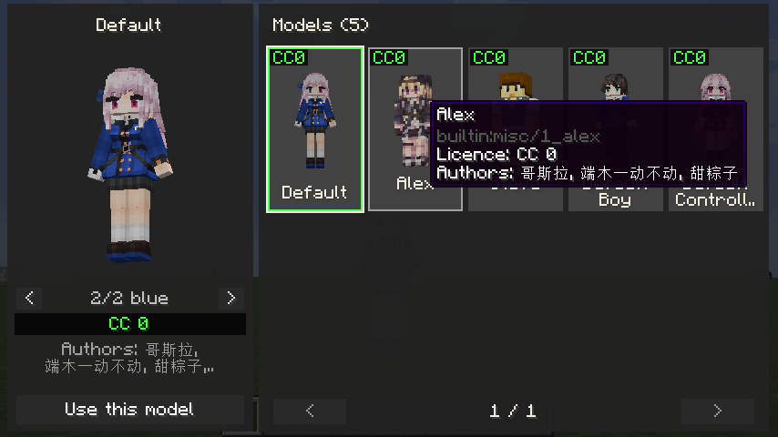
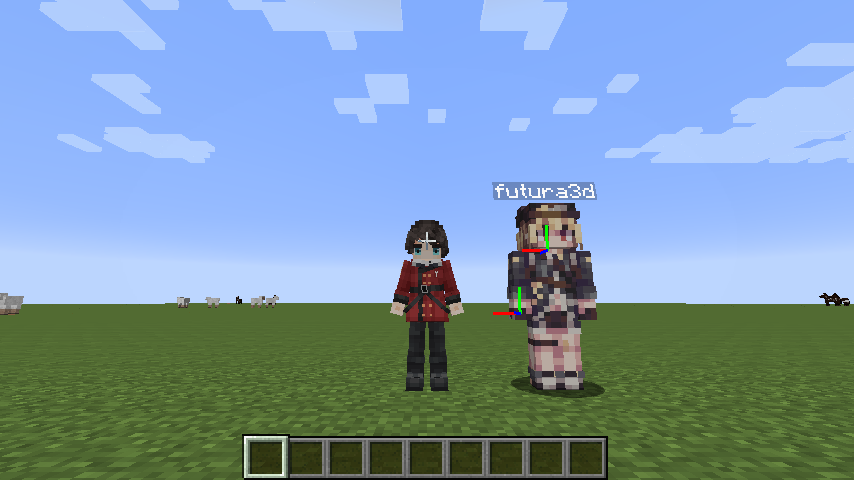
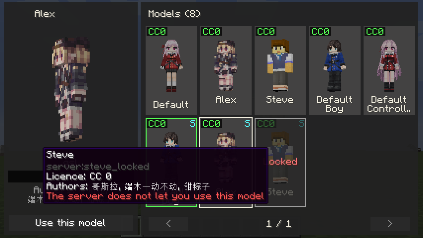

Harness (`dev/RenderHarness.pickerSteps`, `futura3d-harness` com `only picker`): seletor aberto, seletor com os
modelos carregados e a dica, só CC0, a segunda página (poses de GUI autorais e a segunda textura da Momo), `requestLocal`
de `builtin:wine_fox/18_wedding` (o jogador local muda, a escolha é gravada), dois jogadores com modelos diferentes
(Wedding e Default azul), três modelos registrados como o servidor faria (pasta, memória e um travado, cópias de
modelos CC0 embutidos), o seletor com eles, e a volta ao `builtin:default` depois de `clearServerModels`. No fim,
`requestLocal(null, null)` apaga a escolha gravada.

**A checar**:

* Lado a lado com o YSM 1.20: as poses de GUI autorais (`preview_animation: gui` dos `wine_fox` mostra uma moldura
  `Backgrounds` atrás do personagem, que no harness sai cinza clara e grande no cartão: o enquadramento inclui a
  moldura, como o do upstream, mas a cor e a proporção não foram comparadas), o ângulo da câmera dos cartões
  (aqui de frente para pose autoral e a 20° para idle) e a luz da prévia.
* Com a rede (fase 4a): o handler, `locked` vindo do servidor, a troca de modelo de outro jogador ao vivo e
  `clearServerModels` ao desconectar; aqui só foram exercitados pelo harness, sem rede. Com a fase 4a, o registro
  dos modelos do servidor, `clearServerModels` a cada catálogo novo e a troca do próprio jogador foram vistos com um
  servidor dedicado; a troca de outro jogador ao vivo e o `locked` foram vistos no teste do TEOF 5.3.
* Tempo de carga fora do harness (aqui, de 10 a 360 ms por modelo nas threads de carga, a maior parte na primeira
  carga, com o JIT frio) e o custo do seletor com dez prévias animadas numa máquina fraca.
* Nomes CJK e com códigos `§` nos cartões em outras escalas de interface; um zip de verdade arrastado por um usuário
  (o carregamento local de pastas e zips ainda não tem tela: as fontes existem para a rede e para a fase seguinte).

Testes: 253 (fontes de modelo, `ModelInfo` e o índice dos embutidos, `ModelFraming`, a escolha gravada e o contrato de
`ModelSelection` sem o jogo).

## Teste no TEOF 5.3

Primeira vez que os jars de release (reobfuscados, sem o pacote `dev`) rodaram fora do ambiente de dev: uma cópia do
servidor de produção (Crucible, Java 21, lançado como em produção, `java @java9args.txt -jar server.jar nogui`, modo
offline) atualizada para os mods do TEOF 5.3, e dois clientes com o `.minecraft` do TEOF 5.3 inteiro (215 mods,
Angelica 2.2.43, Backhand 1.8.13, `akashicplayer` com o isolamento de render, Kunftig, GeckoLib), Java 8, sob Xvfb
com Mesa llvmpipe. Os clientes usam o jar com o harness (`dev/TeofHarness`: `teof <host>:<porta> <A|B> <pasta>` em
`futura3d-harness`; os dois percorrem a mesma lista de etapas e se esperam numa barreira de arquivos); o servidor usa
o jar de release. Modelos no servidor: cópias dos embutidos CC0 `misc/1_alex`, `misc/2_steve` e, em `auth/`,
`misc/3_default_boy`.

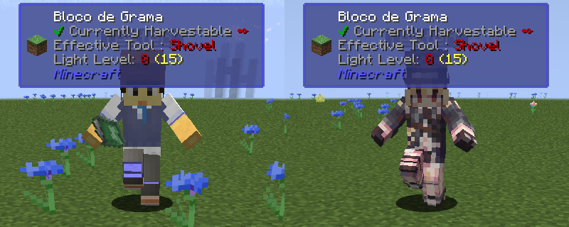
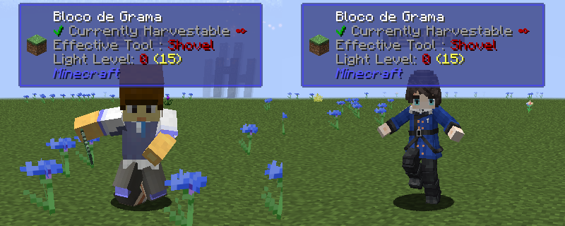
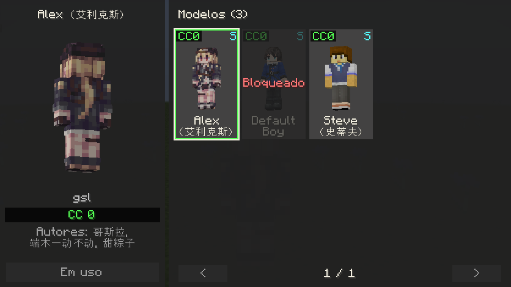
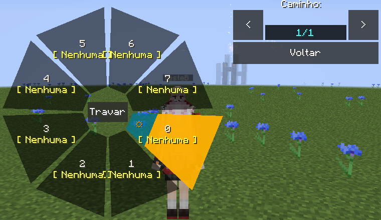

**Verificado** (os dois logs e as fotos):

* O cliente 5.3 entra no Crucible com Java 21; o canal FML `futura3d:model` convive com os plugins Bukkit (ProtocolLib,
  TAB, Essentials, LuckPerms...). O catálogo de 3 modelos (951 811 bytes) baixa na entrada; na segunda entrada vem do
  cache (0 bytes).
* **Mixins reobfuscados aplicam**: o harness procura os métodos dos handlers nas classes do jogo (`RenderPlayer`,
  `ItemRenderer`, `RenderFish`) e acha os seis handlers dos quatro mixins (`redirect$...$futura3d$drawModel`, `handler$...$futura3d$drawModelArm`,
  `...$beginFrame`, `...$drawBackground`, `...$lineStart`, `...$lineVertex`); nenhum aviso de mixin, refmap ou
  injeção do futura3d nem do Kunftig nos logs. O `akashicplayer` transforma o `RenderPlayer` por ASM e o redirect
  continua lá: nada é desenhado duas vezes (o bíped vanilla some sob o modelo).
* **Dois jogadores ao mesmo tempo** (o ponto que faltava da fase 4a): `/futura3d set` troca os dois e cada cliente vê
  o modelo do outro; o emote que B toca pela própria roleta (`C_EMOTE`, sem comando) chega a A, e o
  `/futura3d play` de A chega a B (`isPlayingExtra` do animador do outro jogador verdadeiro nos dois); a escolha pelo
  seletor (`requestLocal`, o mesmo caminho do botão) vai ao servidor e B vê A trocar; o modelo restrito é recusado
  (A continua com o anterior), e depois de `/futura3d auth ... add` o mesmo pedido passa e B vê a troca. Num servidor
  offline o UUID de sessão dos clientes (aleatório, como uma conta original) difere do do servidor, e a tradução do
  hello funciona.
* Teclas: Y abre o seletor, Z a roleta (disparadas pelo `KeyBinding` e pelo evento de tecla do FML, como o teclado).
* Nome sobre a cabeça do outro jogador, sombra, item na mão (o livro do TEOF na mão do Steve), a prévia do jogador no
  inventário de sobrevivência (com o NEI aberto), a primeira pessoa (o braço do modelo; espada vanilla).
* Vara: a linha sai da vara na mão do modelo, com a boia moderna do Kunftig; o Kunftig acha a API
  ("3D Futura Engine found; rods and blades follow its player models").
* **Backhand (corrigido nesta etapa)**: o Backhand desenha a segunda mão em `RenderPlayer.renderEquippedItems`, que um
  jogador com modelo nunca alcança, então o item da segunda mão sumia. Agora, com o Backhand presente,
  `client/BackhandOffhand` liga o `BackhandUtils.getOffhandItem` ao `PlayerModels.setOffhandSource` (por reflexão) e o
  item vai no `LeftHandLocator` (foto: tocha na mão esquerda do modelo; à direita, o mesmo com os modelos desligados).
  Em primeira pessoa o Backhand não desenha a segunda mão nem com os modelos desligados (então não é o futura3d).
* Angelica 2.2.43 com shaders desligados, GL 4.5 core da Mesa (llvmpipe): as display lists do modelo desenham sob o
  gerenciador de estado do Angelica sem nada a mais.

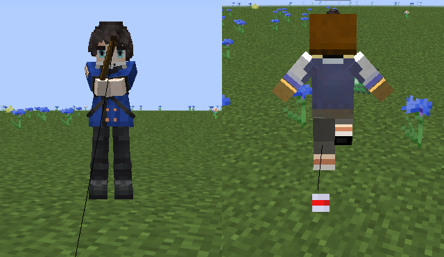
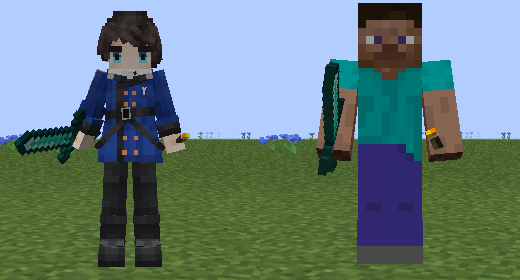
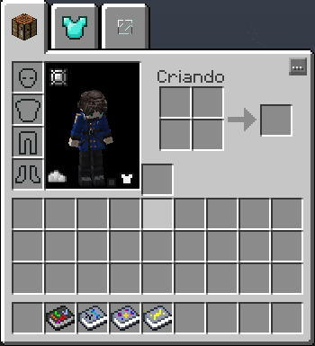
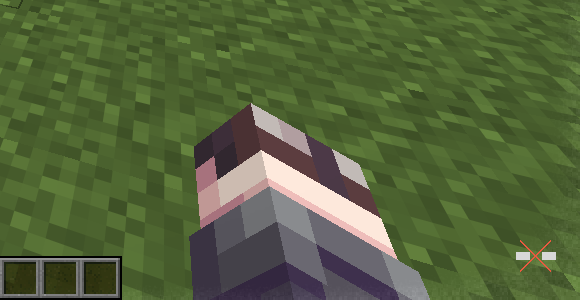

Tempo de quadro no cliente A (llvmpipe, 1280x720, `renderDistance` 4, os dois clientes e o servidor na mesma máquina
de 4 núcleos: **só serve para comparar entre si**), média de 240 quadros, duas rodadas:

| | Rodada 2 | Rodada 3 |
|---|---|---|
| 2 jogadores com modelo visíveis | 142,1 ms | 142,0 ms |
| os mesmos 2, modelos desligados | 152,8 ms | 137,1 ms |
| só o próprio modelo (o outro atrás da câmera) | 137,8 ms | 138,8 ms |
| o mesmo, modelos desligados | 136,4 ms | 135,7 ms |

A diferença entre modelo e vanilla fica dentro do ruído: com o modpack inteiro, o resto do quadro domina e os modelos
CC0 pequenos (282 a 936 quads) não aparecem na conta. Memória: cada cliente com `-Xmx2304M` ocupa uns 4,4 GB
residentes (a heap viva fica em 1,7 GB depois de um GC completo); o cliente leva de 20 a 30 minutos para chegar ao
menu nessa máquina.

Achados fora do futura3d:

* Na primeira rodada, com os dois jogadores teleportados 60 blocos acima do chão, A nunca recebeu a entidade de B
  (B via A, e o JourneyMap de A mostrava B no radar pelos dados do servidor). Nas outras duas rodadas, no chão, os dois
  se viam desde o início. Parece o rastreador de entidades do servidor (que só manda um jogador a quem já recebeu o
  chunk dele), não o futura3d: **a checar** em produção se jogadores somem uns para os outros depois de um `/tp`.
* O Crucible registra o comando com o nó de permissão `com.akashic.futura.server.FuturaCommand` (o nome da classe):
  para dar o comando a quem não é operador pelo LuckPerms, é esse nó.
* O JourneyMap mostra os outros jogadores pelo UUID em vez do nome num servidor offline.

**A checar**:

* Lâminas do Kunftig (`KunftigBlades`) e as varas 3D (`KunftigRods`) em modelos: precisam do plugin que manda os
  dados (o AkashicFishing e o Overkill não estão no servidor); a linha e a boia foram vistas.
* Shaders do Angelica ligados e uma placa de vídeo de verdade (aqui só llvmpipe sem shaders); o custo de modelos
  grandes (`wine_fox`) com vários jogadores perto.
* Modo online, links lentos e muitos jogadores baixando juntos; o clique de mouse no botão do seletor (o teste chamou
  o mesmo `requestLocal` do botão).
* A segunda mão do Backhand espelhada (o item usa a transformação da mão direita) e a segunda mão vista pelo outro
  jogador (no teste foi posta só no cliente que a fotografou).

Testes: 313 (sem mudança: a ponte do Backhand depende do FML carregado).

## Fase 5a: controladores Bedrock, funções do modelo e sons ("Tier 2")

Tudo em `anim` (Java puro, testado), mais uma cola mínima no cliente para o som. O carregador (`model/ModelLoader`)
agora lê também os arquivos de `files.player.animation_controllers` (`LoadedModel.controllers`, um arquivo posterior
substitui um controlador de mesmo nome), os `.molang` de `function_path` (padrão `functions/`, recursivo, na ordem do
upstream: arquivos da pasta por nome, depois as subpastas) e a lista de sons de `sound_path` (padrão `sounds/`; o
`files.player.sound_path` antigo também). Para achar essas pastas, `ModelSource` ganhou `list()`: pasta, zip, memória
e os embutidos (pela URL do `ysm.json`: diretório no dev e nos testes, entradas do jar no jar de release, com teste
que monta um jar).

| Upstream | Aqui |
|---|---|
| `geckolib3/core/controller/BedrockAnimationController`, `expression/host/ControllerExecutionState` | `anim/BedrockController` |
| `geckolib3/core/controller/HybridAnimationController` | `anim/HybridController` |
| `geckolib3/core/controller/transition/{IBlend,LinearBlend,SegmentedBlend}Transition` | `anim/BlendCurve` |
| `format/parser/AnimationControllerBuilder`, `AnimationProtoMapper.controllerFile`, `builder/controller/*` | `anim/ControllerData` |
| `client/controller/{Multi,Single,Parallel,Armor}ControllerDiscovery`, `collections/*ControllerCollection` | `anim/ModelAnimations` (descoberta), `PlayerControllers`, `FirstPersonControllers` |
| `ModelRenderTargetLoader.commonAssets` (funções `<nome>@<evento>`), `expression/inventory/MolangEventCatalog` | `anim/ModelFunctions` |
| `EntityExpressionRuntime` (`dispatchPlayerInit/Update/Sync/Deferred`, `codedController`) | `anim/PlayerAnimator`, `CodedController` |
| `geckolib3/core/event/SoundKeyframeExecutor`, `InstructionKeyFrameExecutor` | `anim/AnimationPlayer` |
| `client/sound/instance/SoundInstanceManager`, `expression/host/ModelSoundId` | `anim/SoundScope` |
| `expression/host/builtin/ModelBuiltins` (`play_sound`, `stop_sound`, `stop_all_sounds`, `sync`, `defer`) | `anim/PlayerMolangContext` |
| `client/sound/instance/*` (tocar no jogo) | `client/ModelSounds` (paulscode da 1.7.10), `client/SoundBytesUrl` |

### Controladores Bedrock

* Estado inicial `initial_state` (padrão `default`); a cada quadro as transições do estado atual são testadas na ordem
  em que foram declaradas e a primeira verdadeira vence. Um estado que não toca nada é deixado no mesmo quadro se uma
  transição dele vale, sem visitar um estado duas vezes no quadro (laço `a → b → a` termina).
* `animations`: nomes ou `{nome: condição}` (condição em branco vale sempre); todas tocam juntas, cada uma num
  `AnimationPlayer` próprio, e a mistura por osso é a do `BlendBoneAnimationQueue` do upstream: valores somados pelo
  `blend_weight` de cada clipe (escala multiplicada com peso), um clipe saindo pesa `1 - progresso` e o resultado
  desvanece pelo menor progresso; na entrada, os alvos somados são interpolados desde a pose que o osso tinha.
* Numa transição de verdade: param os sons que o controlador tocou, roda o `on_exit` do estado velho, o `on_entry` do
  novo (cada lista vira um programa só, linhas terminadas por `;`, como `compileStatements`), tocam os
  `sound_effects` do estado, e cada animação recomeça com o `blend_transition` do estado (número = linear em
  segundos; objeto `"segundos": peso-da-pose-velha` = curva por segmentos; ausente = sem transição).
* `query.all_animations_finished` / `any_animation_finished` são as do controlador que está rodando (Bedrock: das
  animações que se aplicam; codificado: a do seu clipe, como antes).
* `ysm-builtin`: o estado não toca nada e o `HybridController` passa o quadro ao predicado codificado de mesmo nome,
  cujo clipe entra com o `blend_transition` desse estado; ao sair, o codificado é reiniciado. `ysm-entry-<x>` roda o
  controlador `<nome>.<x>` enquanto está no estado (até 5 níveis).
* Substituição: todo controlador do jogador menos `cap` é um `HybridController`; se o modelo declara um controlador
  com o mesmo nome (`player.main`, `player.hold_mainhand`, `player.parallel_3`, `player.armor_head`...), ele roda no
  lugar do predicado. Declarado vazio (`{}`, há dois nos embutidos) substitui por nada, como no upstream.
* Criados só quando declarados (controlador nos arquivos ou função `player_ctrl_<nome>`), na ordem do upstream:
  `pre_main*`, `post_main*`, `pre_hold*`, `post_hold*`, `pre_swing*`, `post_swing*`, `pre_use*`, `post_use*`
  (`MultiControllerDiscovery`: o nome exato e `<nome>_*`, em ordem alfabética), `parallel_*`/`pre_parallel_*` além
  dos que vêm de animações `parallelN`, e `armor_<slot>` também para `mainhand`/`offhand`. Primeira pessoa:
  `fp.arm.misc` quando declarado (vai primeiro) e `fp.arm.parallel_*` declarados.
* `blend_via_shortest_path` é lido e não muda nada: a mistura de rotação já é por quatérnio normalizado (caminho
  mais curto), e o upstream 2.x também ignora o campo.

### Funções e eventos

* `functions/<nome>@<evento>.molang`: `nome.molang` só se chama, `@evento.molang` só trata o evento,
  `nome@evento.molang` as duas coisas. `fn.<nome>(a, b)` chama com `args[0]`, `args[1]` (o interpretador ganhou
  `MolangContext.index` para `simbolo[i]`; argumento ausente é valor ausente, `??` funciona), os `t.*` da função são
  dela, `return` devolve; chamadas aninhadas param em 16 níveis (o upstream recusa recursão ao compilar).
* Eventos, como o catálogo do upstream: `player_init` (uma vez, no primeiro tick do animador), `player_update` (todo
  tick, `args[0]` = 1, antes dos controladores), `sync`, `defer` e `<categoria>_ctrl_<nome>`. Outros sufixos são
  ignorados. A primeira pessoa só fica com `defer` e os de controlador.
* Sobreposição de controlador codificado: o primeiro tratador de `player_ctrl_<nome>` roda antes do predicado (com o
  contexto de animação do controlador, então `ctrl.set_animation`, `ctrl.set_beginning_transition_length` e os sons
  vão para ele); resultado exatamente 2 continua, 3 para, 4 pausa, qualquer outro valor deixa o predicado Java
  decidir.
* `ysm.defer(atraso, valores...)`: guardado (no máximo 64 por quadro) e entregue aos tratadores `@defer` com
  `args` = atraso e valores, do mais novo para o mais velho, depois dos eventos e no fim do quadro. O atraso não espera
  tempo nenhum (no upstream também é só um argumento). Simplificado: o contexto de animação de quando foi pedido não é
  restaurado.
* `ysm.sync(valores...)` (até 16): vai para um `anim/SyncSink` do animador. Sem sink, ou se ele recusa, os tratadores
  `@sync` rodam na hora (o upstream sem servidor faz isso). **Encaixe para a rede** (outro trabalho):
  `client/ModelSync.setTransport(Transport)`; com o transporte conectado, o `ysm.sync` do jogador local vai para
  `send(values)` e o de outros jogadores não faz nada; o que o servidor repassar entra por
  `ModelSync.receive(jogador, valores)` → `PlayerAnimator.dispatchSync`.

### Quadros-chave de instrução e sons

* `timeline` já rodava (fase 2); agora com teste de tempo (cada instrução no tick em que a reprodução passa por ela, as
  que faltam rodam na volta do laço) e de `merge_multiline_expr` (as linhas de uma entrada viram um programa e dividem
  os `t.*`).
* `sound_effects` dos clipes tocam quando a reprodução passa por eles (só nos quadros que executam eventos), e param
  quando o laço recomeça ou o clipe acaba (o upstream faz igual: a música de um emote em laço é cortada na volta).
* `ysm.play_sound(id, nome, modo = 0, volume = 1, pitch = 1)`: id numérico (0 anônimo, negativo nunca toca) ou texto,
  que não se confundem; modo bit 1 substitui o som ainda tocando com o mesmo id (sem ele, o pedido é recusado), bit 2
  usa o escopo do jogador, bit 4 repete. `ysm.stop_sound(id, global)`, `ysm.stop_all_sounds(global)`. Escopos, como o
  upstream: o da animação rodando, senão o do controlador Bedrock, senão o do jogador.
* Os `sound_effects` de um estado de controlador tocam na entrada do estado. **Diferente do upstream 2.x**, que tem a
  chamada mas nunca toca (o mapeamento do container passa uma lista vazia e o teste está invertido); o YSM antigo
  tocava.
* No jogo (`client/ModelSounds`): um nome sem `:` é um arquivo da pasta de sons do modelo, tocado direto no
  `SoundSystem` do paulscode que o `SoundManager` da 1.7.10 guarda (alcançado por reflexão, nomes MCP e SRG), com uma
  URL `futura3d:` que serve os bytes lidos do modelo (`SoundBytesUrl`). Arquivos até 256 KiB são decodificados e
  guardados pelo paulscode (liberados quando o modelo é liberado); maiores tocam em streaming. Posicional no jogador
  (atenuação linear, distância `16 × max(volume, 1)`), seguindo-o a cada tick, volume × categoria "Jogadores", pitch
  limitado a 0,5–2 (o OpenAL; o upstream aceita 0,001–1000). Um nome com `:` é um evento de som vanilla, tocado como
  `ISound` que segue o jogador. Limites: 6 sons por jogador e 16 ao todo (o upstream não limita). Param quando o
  jogador some, muda de mundo ou de modelo.
* ~~**Opus**: o conversor do upstream grava Ogg Opus, e alguns embutidos (`wine_fox/14_momo`: `fly_on`, `sfmb`,
  `dooble`, `owo`) já são Opus; a 1.7.10 só decodifica Vorbis (JOrbis). Esses arquivos são pulados com uma linha no
  log (`Skipped sound ... Ogg Opus`). Os outros 50 `.ogg` embutidos são Vorbis.~~: tocam pelo Concentus desde a etapa 6 (item 3).

### Resultado

Harness (`dev/RenderHarness.controllerSteps`, `futura3d-harness` com `only ctrl`), Xvfb + llvmpipe:

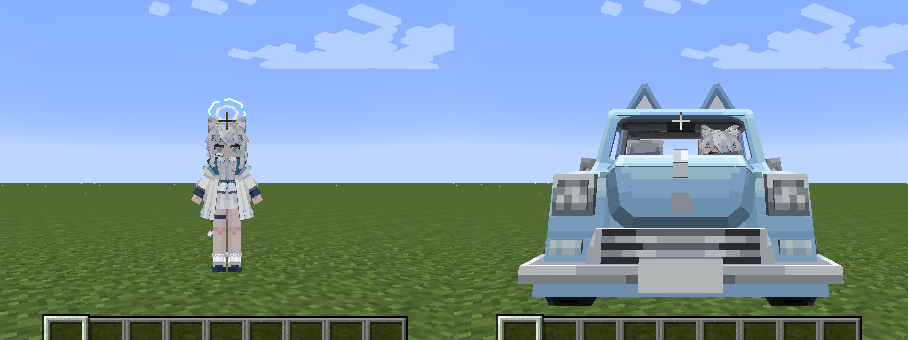
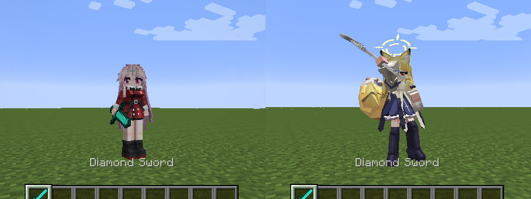

Do relatório do harness (`run/client/futura3d-harness.txt`): `player.post_hold [bedrock] sword` e
`player.post_swing [bedrock] attack2` no modelo de controladores padrão; `player.pre_main Coded -> 开车_行走` (a
função do modelo decidindo) e `player.parallel_2 [bedrock] 常态` na Kluonoa andando de carro; `player.post_swing
[bedrock] 剑2` na Saint. Sons, verificados pelo que o sistema de som recebeu (`Model sound ... handed to the sound
system`): `atk1`/`atk2`/`atk3ready`/`atk3` (quadros-chave dos golpes da Saint), `shengyin`/`magic01` (arco puxado;
`magic01` com 465 KB em streaming) e `magic01_shoot` (a função `ArrowShoot@player_ctrl_use` ao soltar o arco, modo 3),
`get_down` (emote `extra3` da Wedding, streaming), e o `dooble` Opus da Momo pulado. Sem placa de som, o OpenAL Soft
foi posto para gravar num WAV (`~/.alsoftrc` com `drivers = wave`): o sistema de som inicializa e mistura, mas o
arquivo gravado pelo processo encerrado à força não serve para conferir quais sons saíram. A decodificação em si tem
teste: `SoundDecodeTest` passa um `.ogg` embutido pela URL de memória no `CodecJOrbis` da 1.7.10 e confere o áudio.

Os sons de eventos de 1.20 que os modelos pedem (`minecraft:item.trident.throw`, `minecraft:entity.player.attack.knockback`)
não existem na 1.7.10: uma linha no log por nome e nada toca.

**A checar**:

* Lado a lado com o YSM 1.20 nos modelos com controladores (`misc/4_default_controllers`, Kluonoa, Saint, Momo,
  Sta): os estados e as misturas foram portados linha a linha, mas só testes e fotos os viram.
* Ouvir os sons num cliente de verdade: volume, distância, o pitch limitado, a música longa em streaming, os 6 por
  jogador; e o que o jogo pausado faz (os sons do modelo não pausam com o menu, os vanilla sim).
* Modelos do servidor: `net/CachedModelSource` ainda não implementa `list()`, então modelos vindos do servidor não
  acham funções nem sons (controladores sim, porque estão no `ysm.json`). É uma linha no pacote `net` (devolver as
  chaves do mapa de arquivos), deixada para quem cuida da rede.
* `ysm.sync` pela rede: o encaixe (`ModelSync`) existe, o transporte não (outro trabalho).
* `defer` sem restaurar o contexto de animação da chamada; `ysm.keyboard` continua 0 (os códigos GLFW não são os do
  LWJGL 2).
* O arco vanilla na mão da Saint depois do tiro sai grande ao lado da cabeça na foto do harness (posição de item da
  fase 3a com a pose de arco do modelo), não investigado aqui.

Testes: 365 (52 desta fase: máquina de estados, transições em ordem, entrada e saída, estados vazios e laços, soma
por `blend_weight` e condições, `ysm-builtin`, substituição do `player.main`, curva de mistura, subcontrolador,
sons de estado, controladores opcionais e de primeira pessoa; funções com `args`, `t.*` próprios, recursão cortada,
`player_init`/`player_update`, sobreposição de controlador, `sync` com e sem sink, `defer`; tempo das instruções e
`merge_multiline_expr`; quadros-chave de som, modos e ids do `play_sound`; listagem de pastas, zip, memória e jar;
decodificação Vorbis e detecção de Opus; e todos os embutidos com controladores ou funções animados por 600 quadros,
corpo e braços, sem NaN e sem som sobrando).

## Fase 5b: `v.roaming` e `ysm.sync` pela rede, formulários da roleta, combos de lâmina

### Protocolo 2

`Protocol.VERSION = 2`, ainda falando 1 (`MIN_VERSION`). O servidor responde no hello do cliente com a versão dele e
nunca manda a um cliente 1 um tipo novo; um cliente 2 num servidor 1 recebe o hello do servidor sozinho (versão 1, sem
modelos, como o 1 sempre respondeu a uma versão diferente) e diz hello de novo com 1 (`ClientSession`). Os dois lados
ignoram os tipos novos numa sessão 1. Versão fora de `MIN_VERSION..VERSION`: só o hello, como antes.

| Tipo | Sentido | Campos |
|---|---|---|
| 8 `S_ROAMING` | S→C | UUID, `reset`, até 16 × (nome, float) |
| 9 `S_SYNC` | S→C | UUID, até 16 floats |
| 68 `C_ROAMING` | C→S | `reset`, até 16 × (nome, float) |
| 69 `C_SYNC` | C→S | até 16 floats |

* Nomes de `v.roaming.*` sem o `roaming.`: 1 a 32 bytes de `a-z 0-9 _` em partes separadas por um ponto
  (`Protocol.validRoamingName`, o limite de nome do upstream), sem repetição numa mensagem; floats finitos; tudo
  conferido antes de alocar, nos dois sentidos (o codificador recusa o que o decodificador recusaria). Nunca Molang:
  nomes e números.
* Servidor (`ModelServer`): guarda até 64 variáveis por jogador (`MAX_ROAMING_VARIABLES` do upstream; nomes além
  disso ficam fora), apagadas quando o modelo dele muda (as variáveis são de um modelo; os clientes também as
  esquecem); repassa a quem o rastreia e fala a versão 2; `reset` apaga as outras antes. `ysm.sync` vai a quem o
  rastreia **e de volta a quem mandou** (como o `MolangSyncEvent` do upstream). Taxa: 10 por segundo, rajada de 20,
  para cada um dos dois.
* **Quem começa a rastrear** (`PlayerEvent.StartTracking` do Forge, depois do pacote de spawn): recebe o emote que o
  outro toca e as variáveis dele (a primeira mensagem com `reset`). O emote começa do início (o tempo decorrido não
  vai). O cliente diz "parou" quando um emote de uma vez acaba sozinho, para o servidor não mandá-lo mais.
* Cliente (`client/net/ClientNetwork`, núcleo puro em `net/RoamingTracker` e `net/RemoteRoaming`): a cada tick
  compara as variáveis `roaming.*` numéricas do animador local com o que o servidor sabe e manda só a diferença, no
  máximo a cada 4 ticks (um slider arrastado manda o último valor); uma variável que some, ou um modelo novo, manda
  tudo com `reset`. As dos outros ficam por UUID e são escritas no animador de cada um sempre que mudam ou o animador
  é trocado (o modelo dele terminou de carregar).

### `ysm.sync` (reconciliado no merge das fases 5a e 5b)

`ysm.sync(...)` no `PlayerMolangContext` vai a `PlayerAnimator.sync`, que usa o `SyncSink` do animador
(`client/ModelSync`, fase 5a). Enquanto o servidor fala o protocolo 2, o transporte instalado pelo `ClientNetwork`
manda os números do jogador local como `C_SYNC` (balde de 10/s também no cliente) e os modelos dos outros jogadores
não disparam sozinhos; sem servidor, os handlers `@sync` do modelo rodam na hora. O que chega (`S_SYNC`, inclusive o
eco do próprio) passa por `net/MolangSync.receive`, que guarda o último evento para o harness e chama
`PlayerAnimator.dispatchSync`, rodando os handlers `@sync` do modelo daquele jogador. Os modelos vindos do servidor
listam seus arquivos (`CachedModelSource.list`), então também têm funções e sons.

### Formulários da roleta (`emote/ConfigForm`)

O painel da engrenagem agora edita: `checkbox` escreve 1 ou 0 na l-value do `value`, `range` escreve o valor preso a
`min..max` e arredondado ao `step` a partir do `min` (slider: clique e arraste), `radio` lê o índice do rótulo pelo
valor arredondado (fora da faixa: o primeiro) e, no clique, roda a ação Molang do rótulo (`"v.roaming.eye=2"`; rótulo
sem ação escreve o índice). Tudo no contexto Molang do animador local, sem rede: o que é `v.roaming.*` vai pelo
rastreador acima, o resto fica local. Só l-values de variável (`v.`, `variable.`, `r.`, `roaming.`) são escritas,
por um programa por formulário (`<value> = v.futura3d_config_value`). O upstream manda uma ação ao servidor, que a
repassa e cada cliente roda o handler local; aqui as variáveis não-roaming não chegam aos outros (**a checar** se algum
modelo depende disso). Roda do mouse sobre o painel rola; a descrição aparece na dica.

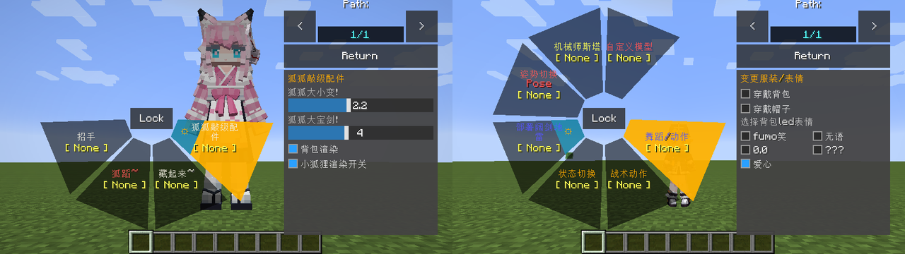

### SlashBlade nos modelos: estados externos (API 3)

`api/FuturaModels.API_VERSION = 3`: `setExternalState(jogador, chave, valor)` / `externalState`, `hasAnimation`,
`playingAnimation`. Os estados ficam por UUID em `anim/ExternalStates` (chave ≤ 64, valor ≤ 128, 16 por jogador, 512
jogadores, apagados ao sair do mundo); cada mudança de valor muda a geração da chave, então limpar e pôr o mesmo valor
recomeça o que ele começou. O runtime (`anim/SlashBladeStates`, de `SlashBladeAnimation`/`SwingPredicate` do upstream):

* `slashblade.held` (qualquer valor; também um `ItemSlashBlade` de verdade): a classe `:slashblade` no item da mão
  (`hold_mainhand:slashblade`, `swing:slashblade`...) e o estado principal tentado como `slashblade:<estado>`
  (`slashblade:idle`, `slashblade:walk`...), como `playMainAnimation`.
* `slashblade.combo` (`combo_a1` ou `slashblade:combo_a1`; o `NAME_FIX` `combo_a4_ex` → `combo_a4ex`): tocado uma
  vez no controlador `swing`; enquanto há combo, o golpe comum não toca; um combo que o modelo não tem só segura o
  golpe. Diferente do upstream: um clipe que terminou não recomeça sozinho (o upstream recarrega a cada quadro; aqui um
  nome cobre a corrente inteira do SlashBlade e dura mais que o clipe), só quando a geração muda.
* `ctrl.slashblade_animation` dá o combo. Todo modelo cai no conjunto `slashblade` do modelo padrão, como no upstream.

O Kunftig chama isso por reflexão (ver o Kunftig, `docs/playermodel/ESTUDO-YSM.md`, seção 10): diz `slashblade.held`
enquanto a mão segura uma lâmina dele e `slashblade.combo` com o nome do estado do SlashBlade pelo primeiro quadro da
corrente que o servidor manda; com o modelo tocando as animações, a lâmina vai nos três locators como no
`newMainhandSlashBlade` do upstream e a visibilidade vem dos clipes.

### Resultado

* Harness do futura3d (`only config`, mundo de um jogador, o servidor integrado fala o protocolo 2): os quatro
  formulários da Momo escritos (`v.player_size` 2,2, `v.roaming.back` 1); o servidor recebe
  `{back=1.0, smallfox_size=1.0, end_rod=0.0}` (as outras duas o próprio Molang do modelo põe); `ysm.sync(1, 2.5,
  v.roaming.back)` volta do servidor como `[1.0, 2.5, 1.0]` para o animador local; o rádio de `v.roaming.bagemotion`
  da Sta vai como 4.
* Harness do Kunftig (`modelcombos`, o jar de dev do futura3d em `run/client/mods`, a lâmina substituta): o log de
  cada foto confere `main=slashblade:idle`, `hold=hold_mainhand:slashblade`, `swing=slashblade:combo_a1`,
  `slashblade:combo_a3`, `slashblade:aerial_rave_a1` durante as correntes e `swing` vazio depois; o outro jogador
  visto de lado e o modelo default também.

**A checar**:

* Com dois clientes num servidor dedicado: as variáveis e o `ysm.sync` entre jogadores, o emote ao chegar perto, e
  um cliente 1 com um servidor 2 e vice-versa (testado com sessões reais pelo codec, não com jars de versões
  diferentes).
* O emote de quem chega perto começa do início, não do ponto em que está.
* Os handlers `sync` do modelo (a outra frente); os formulários com variáveis não-roaming vistos pelos outros.
* Lado a lado com o YSM 1.20 e o SlashBlade de verdade: a pose do `slashblade:idle` (a lâmina embainhada sai de lado)
  e os nomes dos combos além dos que o harness do Kunftig confere.

Testes: 337 (24 desta fase: codec e limites do protocolo 2, negociação de versão, retransmissão, limites e taxa,
`StartTracking`, cliente 1, rastreador e armazém das variáveis, seam do `ysm.sync`, formulários com os modelos
embutidos, estados externos e o SlashBlade no `wine_fox/13_matured` e no `misc/1_alex`).

## Etapa 6: paridade de interpretação e carregador nativo

Sete itens; cada um tem o seu documento em `docs/etapa6/` (mapa do upstream, o que é igual e o que difere de
propósito, testes, resultados e a lista **A checar**). Testes: 534 (eram 337 no fim da fase 5b).

| # | Item | Documento | Estado |
|---|---|---|---|
| 1 | Carregador de `.ysm` legado: v1/v2 em Java, v3 pela biblioteca nativa (Linux x86_64 glibc 2.17+, Windows x64), só em memória, protocolo 3 | [ysm-legado.md](etapa6/ysm-legado.md) | Feito; servidor dedicado e cliente pela rede verificados com um `.ysm` v2; v3 coberto pelo vetor oficial (envelope) e por um modelo sintético (contêiner); **a checar** com um `.ysm` v3 real |
| 2 | Projéteis e veículos (`files.projectiles`/`vehicles`, o antigo `files.arrow`) | [projeteis-veiculos.md](etapa6/projeteis-veiculos.md) | Feito para flecha, boia, barco, carrinho, porco, cavalo e montarias; arremessáveis e bolas de fogo pelo dono que o servidor manda (`S_PROJECTILE_OWNER`, protocolo 3; **a checar** em jogo: nenhum embutido tem alvo para eles) |
| 3 | Sons Ogg Opus pelo Concentus (BSD, relocado no jar) | [opus.md](etapa6/opus.md) | Feito; decodificação conferida contra o libopus; **a checar** ouvindo num cliente |
| 4 | Altura da câmera em primeira pessoa pelo `ViewLocator`/`Head` (só no desenho; opção `view_locator_camera`) | [view-locator.md](etapa6/view-locator.md) | Feito; harness |
| 5 | Nomes traduzidos do `lang/` do modelo na roleta e no seletor (e a mensagem no chat da roleta) | [nomes-traduzidos.md](etapa6/nomes-traduzidos.md) | Feito; harness em zh_CN, en_US e pt_BR |
| 6 | Partições do renderizador nativo e ordem dos translúcidos de trás para frente por quad | [translucidos.md](etapa6/translucidos.md) | Feito; harness antes/depois |
| 7 | Validação e comparação com o YSM 1.20 | [paridade.md](etapa6/paridade.md) | Conferido contra o código do upstream; o lado a lado no jogo não pôde rodar aqui (sem cliente 1.20 nem placa de vídeo): roteiro e lista no documento |

Mudanças que tocam o que já existia:

* **Protocolo 3**: o bit 4 (`memoryOnly`) nas flags do `S_MODEL`; modelos `memoryOnly` não são oferecidos a clientes 1
  e 2, nem os arquivos só deles. Novo `S_PROJECTILE_OWNER` (10: id da entidade, UUID de quem jogou), só a clientes 3.
* **Atrás de proxy (Velocity/BungeeCord)**: achado no teste da rede de produção (lobby Paper → `forbidden-1`
  Crucible). A troca de servidor do proxy refaz o handshake do FML na mesma conexão e o `NetHandlerPlayClient` continua
  o mesmo; a sessão do cliente só recomeçava com um `NetHandlerPlayClient` novo, então o hello ia para o lobby (que não
  responde) e nunca mais era repetido: o Crucible nunca soube que o cliente tem o mod e não mandava catálogo nem
  modelos (o `/futura3d set` mudava só o estado gravado). Agora o cliente recomeça a sessão a cada handshake do FML
  completo (`ClientConnectedToServerEvent`, inclusive o reset do proxy) e repete o hello a cada 2 s por 20 s enquanto
  ninguém responde (um hello que chega antes do `PlayerLoggedInEvent` do servidor novo se perdia); o servidor responde
  de novo a um hello repetido (catálogo e estados), com limite de taxa. Logs: `Handshake from <uuid>: protocol=...,
  sending N models (M memory only)` no servidor, `Server catalog: N models (M memory only)` e `Server switch` no
  cliente; o `/futura3d set` avisa quando o cliente do jogador ainda não fez o handshake. **A checar**: na rede de
  produção, de novo. O cliente guarda esses arquivos na memória da sessão (`VolatileFileCache`), nunca no
  `DiskFileCache`.
* `GeoBaker` lê `poly_mesh` Bedrock (o importador legado escreve um por osso, com `futura3d_cube_faces`); pastas e zips
  no layout 1.x passam a ser lidos no servidor.
* Partições de face: `all_cutout` é o `force_culling` do upstream (antes tratava buracos como opacos), cubo invertido
  pelo teste geométrico do nativo, UVs arredondadas aos texels como o nativo; translúcidos num passe só, ordenados,
  pelo `Tessellator`; iluminação de dois lados para as faces de trás.
* O jar de release passa a sair do `shadowJar` (Concentus relocado em `com.akashic.futura.shadow`), com o pacote `dev`
  excluído também ali; as bibliotecas nativas e `natives/THIRD_PARTY_LICENSES.txt` vão no jar.
* Novo `config/futura3d/client.properties` (opções do cliente: `view_locator_camera`, `print_animation_roulette_msg`),
  separado de `futura3d-client.properties` (a escolha local, que é apagada ao voltar ao padrão).
* Em primeira pessoa o animador do corpo do jogador local agora roda a cada quadro (para a altura da câmera): os sons e
  eventos das animações do corpo também tocam em primeira pessoa.

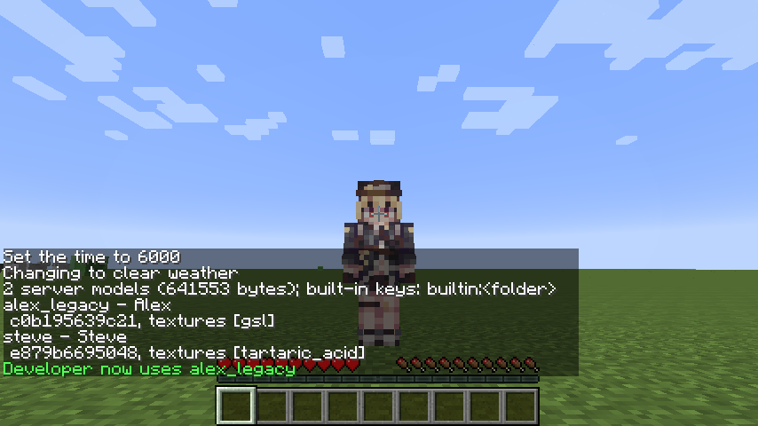

## Modelo padrão: a skin do jogador no Steve/Alex

Pedido da rede depois do teste de produção: o modelo de quem não escolheu nenhum passa a ser o Steve ou o Alex no
esqueleto do YSM (os embutidos `misc/2_steve` e `misc/1_alex`, cujas UVs seguem o layout da skin 64x64: segunda
camada, braço e perna esquerdos próprios), **com a skin do próprio jogador**. O upstream não faz isso (o Steve e o
Alex dele têm textura fixa e o padrão é o modelo `default`).

* `client/PlayerSkins`: a textura vem do perfil do jogador (propriedade `textures`, lida sem rede como o vanilla:
  `MinecraftSessionService.getTextures(perfil, false)`; para o jogador local, `fillProfileProperties` se faltar).
  `model: slim` nos metadados escolhe o Alex. A imagem é baixada aqui (o 1.7.10 corta o que baixa para 64x32), guardada
  em `<mcDataDir>/futura3d/skins/<hash>.png`, e normalizada por `model/SkinImages` como o Minecraft 1.8 faz: skin 64x32
  antiga ganha o braço e a perna esquerdos espelhados dos direitos e segunda camada vazia; camada base opaca; a camada
  do chapéu de skin antiga toda opaca é limpa. Partições de face (translúcido/recorte) pelo alfa da skin de cada
  jogador. Sem skin no perfil (servidor offline sem plugin de skin): Steve ou Alex pela regra do UUID do 1.8+, com a
  textura do próprio modelo.
* `PlayerModels`: sem modelo escolhido, a chave do jogador é a do Steve/Alex; enquanto o modelo escolhido carrega, o
  jogador também aparece assim (antes era o `default`). O `builtin:default` continua carregado: é a reserva e a fonte
  das animações que o Steve/Alex não têm (`main` e `tac` só; o resto vem do padrão, como sempre). Os dois modelos
  carregam no início e nunca são liberados.
* Servidor e protocolo não mudam: "sem escolha" já era a chave nula (`/futura3d set <jogador> default`). O
  `builtin:default` explícito continua escolhível no seletor; o botão **Usar minha skin (Steve/Alex)** volta ao
  padrão.
* Opção `own_skin_default` (padrão `true`) em `config/futura3d/client.properties`: `false` volta ao modelo `default`.
* `FuturaModels.modelKey` de quem usa a própria skin devolve `builtin:misc/2_steve` ou `builtin:misc/1_alex`.

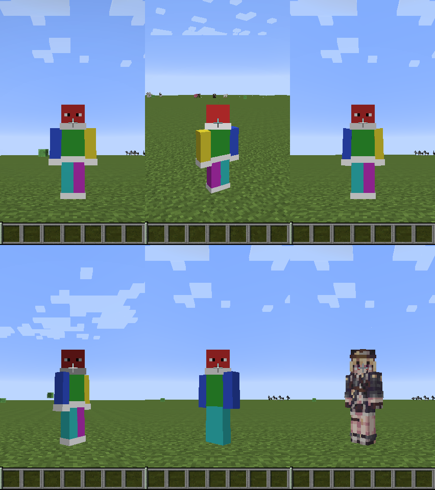

Harness: `only skin`. Testes: `SkinImagesTest` (conversão 64x32, camadas, regra Steve/Alex). **A checar**: skins
reais pela rede de produção (Velocity com skins encaminhadas, ou SkinsRestorer no Crucible offline), a skin de outro
jogador chegando depois do primeiro desenho (ele aparece com a textura do modelo até ela baixar), o olho que pisca
(as pálpebras e pupilas do Steve/Alex leem a faixa x56–64/y0–8 da skin, vazia numa skin normal: o piscar não aparece) e
a capa (não desenhada, como nos outros modelos); o botão novo do seletor (não fotografado).

## Jogadores remotos: chão, voo e caminhada estimados

Relato do teste: os outros jogadores com modelo YSM ficavam flutuando e deslizavam em vez de andar. Causa: no 1.7.10 o
cliente nunca sabe o `onGround` de outro jogador (o pacote de movimento não o traz, e o `EntityOtherPlayerMP` anda por
interpolação, sem colisão: o campo fica `false` para sempre). O estado principal caía sempre em `jump`. O mesmo vale
para `motionX/Z` (ficam com o último pacote de velocidade), `distanceWalkedModified` (nunca cresce) e a habilidade de
voo (não é enviada). No 1.20 o servidor manda o `onGround`, então o upstream não precisa disso.

* `anim/RemoteMotion` (puro, testado): por tique da entidade, chão = caixa de colisão numa fatia de 0,1 bloco sob os
  pés (blocos e entidades, `World.getCollidingBoundingBoxes`), com 3 tiques de tolerância ao descer escada (os pés
  interpolados passam acima do degrau) e saída imediata ao subir (pulo); voo = 8 tiques no ar sem subir nem descer,
  até pousar ou cair rápido; velocidade e distância andada pelas posições, como o `Entity.moveEntity` faria.
* `PlayerInputsAdapter` usa a estimativa só para `EntityOtherPlayerMP`; o jogador local continua com os campos reais.
* Harness `only remote`: um jogador movido como a rede move (`setPositionAndRotation2`, `onGround` falso). Sem a
  correção o estado é `jump` andando, parado e no ar; com ela, `walk`, `idle` e `fly`.

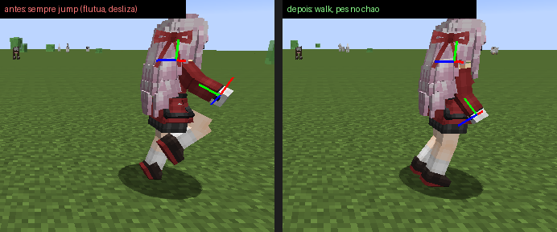

**A checar** no servidor: escadas, lajes, neve e blocos de alturas fracionárias; jogador em pé sobre entidade; voo do
criativo (subindo/descendo segurando espaço/shift); NPCs do Citizens (também são `EntityOtherPlayerMP` no cliente).

## Nado (Ctrl na água) e o Akashic Player Backport

Relato do teste: com o modelo YSM, o nado do [Akashic Player Backport](https://github.com/Akashiic/Akashic-Player-Backport)
(`akashicplayer`) sumiu. O backport decide a pose (nado, rastejar), muda a caixa de colisão e sincroniza a pose com o
servidor, mas desenha a pose no `ModelBiped`/`rotateCorpse` vanilla, que o modelo substitui. O estado `swim` do YSM
existia aqui e nunca ligava (o 1.7.10 não tem pose de nado).

* `client/PoseBridge`: com o backport instalado, a pose dele (`PoseController.getControlledPose`, por reflexão: nenhum
  dos dois mods depende do outro) liga `swim` (pose `SWIMMING`) e o rastejar (`CRAWLING`, os estados `climb`/`climbing`
  do YSM, que no 1.20 são o rastejar). Vale para os outros jogadores também (o backport sincroniza as poses).
* Sem o backport: `anim/SwimState` (puro, testado), a regra do 1.13+ (`Player.updateSwimming`, a mesma do
  `SwimmingDecision` do backport): correndo com os olhos debaixo d'água começa, e dura enquanto corre na água.
* O corpo não é girado aqui: no upstream o `swim` é animação do modelo (o renderizador do YSM não aplica a inclinação
  do `PlayerRenderer`).
* Harness `only swim`: um jogador remoto correndo numa piscina fica em `swim`; parado na água, `swim_stand`.

**A checar** no jogo com o backport alpha.29: nado e rastejar no próprio jogador e nos outros, câmera em primeira
pessoa durante o nado (o backport baixa a câmera; o nosso `ViewCamera` usa a altura do modelo).

## Franja e outras partes sumindo: NaN preso nas variáveis (não era o Angelica)

Relato: partes de modelos do servidor (franja e mechas do Sparkle, da Hu Tao e da Yae Miko) não apareciam, e a
suspeita era o Angelica. Não era: com o Angelica 2.2.43 no cliente de desenvolvimento (`./gradlew runClient -Pharness
-Pangelica`, nunca no jar) os embutidos translúcidos desenham as mesmas partes com e sem ele.

Causa (reproduzida com a Yae Miko, harness `only diag`, modelo em `run/client/config/futura3d/models/<nome>`): esses
modelos fazem física de mola em Molang. O `parallel2` define as constantes (`v.L7_K1/K2/K3`...) em quadros de 0 a
0,42 s, e o `parallel7` integra a cada 0,0101 s dividindo por `v.L7_K2`. Nos primeiros quadros a constante ainda não
existe: `0/0` dá NaN, o NaN era guardado em `v.L7_P0`/`v.L7_P0dot`, realimentava a si mesmo para sempre, e toda escala
e rotação que ele move virava 0 (`1 - 0.002*(NaN)` é um resultado não-finito, 0 no canal). Assim sumiam a franja
(`lh_*`), o peito (`Breast`), os brincos e o que mais dependesse de `L4`/`L7`/`L8`.

Correção (`molang/Nodes.VariableAssign`): um número não-finito atribuído a uma variável a deixa *missing* (lida como 0;
`v.x ?? 1` dá 1), como o upstream trata um F32 não-finito (typed missing) e como já tratávamos valores vindos do jogo.
O NaN não fica mais preso: a física começa em 0 e segue normal quando as constantes chegam. Teste:
`MolangLanguageTest.aNonFiniteValueIsNotStoredInAVariable`. Harness: antes `l7_p0=NaN` e 44 ossos escondidos
(incluindo `lh_front`, `lh_right_a`...); depois `l7_p0=0` parada, `l8_p0` responde ao andar, e só ficam escondidos os
opcionais do modelo (caudas por nível, máscara, asas, armadura...).

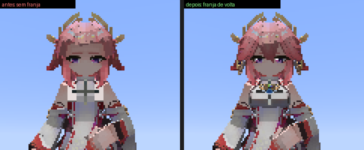

**A checar** no servidor: Sparkle e Hu Tao (mesmo tipo de física; os arquivos não foram testados aqui).

## Escolha lembrada pelo servidor e lobby sem o mod

* **A escolha é lembrada** (`config/futura3d/players/<uuid>.json`): modelo, textura e agora também "a própria skin
  (Steve/Alex)" como escolha explícita (`chosen`). Antes, escolher a própria skin esvaziava o registro (o arquivo era
  apagado) e no login seguinte o servidor aceitava a escolha local antiga do cliente (por exemplo uma Yae escolhida no
  singleplayer). Arquivos antigos que nomeiam um modelo contam como escolha. A escolha local do cliente só vale para um
  jogador que o servidor nunca viu (e se for permitida). Um modelo escolhido continua salvo mesmo se a permissão sair:
  volta quando ela voltar (até lá, a própria skin). `ModelServerTest.theChoiceIsRememberedAcrossRestartsOwnSkinIncluded`
  (servidor reiniciado entre as sessões).
* **Lobby sem o mod:** num servidor remoto que não roda o mod, todos, o jogador local também, ficam com a aparência
  padrão (a própria skin no Steve/Alex); a escolha local salva espera um servidor com o mod. Escolher um modelo ali só
  salva a escolha e avisa no chat (`gui.futura3d.picker.no_server`). Verificado com o harness `connect <host> lobby`
  contra um servidor 1.7.10 vanilla puro: escolha local salva Wedding Wine Fox, desenhado `builtin:misc/2_steve`.
* **Troca de servidor pelo proxy:** além do reset de handshake do FML (que só vem quando o próximo servidor tem
  Forge), `NetHandlerPlayClientJoinMixin` trata cada `S01PacketJoinGame` (o Velocity manda um a cada troca) como troca:
  a sessão de modelos recomeça, e indo para o lobby Paper nenhum modelo ou seleção do forbidden-1 fica.

**A checar** atrás do Velocity: forbidden-1 → lobby → forbidden-1 (no lobby todos Steve/Alex; de volta, cada um com o
modelo que o servidor lembra). O teste com um Velocity local não rodou aqui.

## Vazamentos de memória

Revisão pedida depois do teste de produção. Harness `only leak`: 30 jogadores remotos entram na vista com modelo e
saem (spawn igual ao da rede), GC, e conta quantos continuam na memória; depois 6 resets seguidos do catálogo do
servidor (`/futura3d reload`, o mesmo caminho de uma troca de servidor pelo proxy) contando display lists, texturas e
heap. Com `-Dfutura3d.harness.heapdump=true` (no `JAVA_TOOL_OPTIONS`) grava `futura3d-leak.hprof` se sobrar alguém.

* **Nosso, corrigido.** O animador de cada jogador fica num `WeakHashMap` chaveado pelo jogador, mas o som
  (`ModelSounds.backend`) e o `ysm.sync` (`ModelSync.sinkFor`) do animador guardavam o jogador por referência forte: a
  entrada nunca saía, e com o jogador ficava o `worldObj` dele (o mundo inteiro: atrás do proxy, cada troca de servidor
  deixava o mundo anterior na memória). O mesmo nos projéteis/veículos substituídos (som e `rider`) e no último jogador
  desenhado do `ThirdPersonRenderer`. Agora são referências fracas. Medido: antes 1 em cada jogador com animador ficava
  preso (heap dump: `WeakHashMap$Entry` → lambdas de `ModelSounds`/`ModelSync` → jogador); depois 0 de 30.
* **Do Minecraft 1.7.10, corrigido aqui** (`WorldClientEntityIdMixin`): `WorldClient.addEntityToWorld` põe a entidade
  no `entityList` (um `HashSet`, hash = id) antes de dar o id dela, então a remoção nunca a acha. Jogadores e pinturas
  vêm por esse caminho: todo jogador que entrou no raio de visão ficava na memória até sair do mundo (num lobby cheio,
  horas de acúmulo). O Hodgepodge 2.7.219 do pack não corrige isso (o mixin dele em `WorldClient` é de som). O mixin dá
  o id antes, como os outros spawns do vanilla já fazem. Medido: sem ele, 100 de 100 jogadores ficavam; com ele, 0.
* **Estável:** resets do catálogo (modelos liberados e recarregados): display lists e texturas voltam ao mesmo número
  a cada rodada, heap estável; o cache de Molang tem limite (16 384); as prévias do seletor são liberadas ao fechar;
  sons de modelos liberados são descarregados do sistema de som; skins de quem não é visto há 60 s são liberadas.
* **Servidor:** 500 jogadores entrando e saindo não deixam sessão nem registro na memória (`ModelServerTest`);
  `/futura3d access` de um jogador offline não guarda mais o registro dele.

**A checar** no pack: uso de memória numa sessão longa no lobby com troca de servidores (F3 ou VisualVM).

## Permissões por modelo (`futura3d.playermodel.<modelo>`)

Pedido da rede (controle de quem entra para "trollar"): por padrão ninguém escolhe modelo algum; todos aparecem no
catálogo, visíveis mas bloqueados, e cada nó libera um modelo para um jogador ou grupo. A própria skin (Steve/Alex, a
"skin do Minecraft") fica sempre liberada.

* Nós: `futura3d.playermodel.<nome do modelo em config/futura3d/models>` (nome do arquivo/pasta sem `.zip`/`.ysm`, em
  minúsculas; vale também para os de `models/auth`), `futura3d.playermodel.builtin.<pasta com . no lugar de />` para os
  embutidos (ex.: `futura3d.playermodel.builtin.wine_fox.18_wedding`), `futura3d.playermodel.builtin.*` para todos os
  embutidos e `futura3d.playermodel.*` para todos. O curinga é testado explicitamente também (para o SuperPerms puro);
  com LuckPerms grupos e curingas funcionam do jeito dele.
* Quem decide (`server/ServerPermissions`): no Thermos/Crucible, `Player.hasPermission` do Bukkit por reflexão (o mod
  continua rodando em Forge puro); o Bukkit dá a operador todo nó que ninguém declarou. Sem Bukkit: num servidor
  dedicado operador tem todos e os outros nenhum; no singleplayer (e convidados de LAN) todos têm todos.
* `config/futura3d/server.properties` (as chaves que faltam são escritas com o padrão ao iniciar):
  `requirePermission=true` (false: só os restritos precisam, como antes), `freeModels=builtin:misc/1_alex,builtin:misc/2_steve`
  (chaves `builtin:<pasta>` ou nomes de modelo, separados por vírgula), `permissionCheckSeconds=5`.
* Grants de `/futura3d auth` continuam liberando; `/futura3d set` de operador vale mesmo sem permissão (agora também
  para embutidos). `/futura3d access <jogador>` lista o que ele pode escolher e o nó de cada modelo.
* Protocolo 4: `S_ACCESS` (`bool reset, bool lista_liberados, u8 n, n × chave`, até 192 chaves por mensagem): o
  servidor manda a lista mais curta (as liberadas ou as bloqueadas) depois do catálogo e sempre que muda. As
  permissões são conferidas de novo a cada `permissionCheckSeconds`: o cliente recebe a mudança sem reconectar, e quem
  perdeu o nó do modelo que usava volta para a própria skin para todos. Clientes de protocolo 3 recebem o catálogo de
  novo (o `locked` dos modelos do servidor; os embutidos não ficam marcados neles, mas o servidor recusa a escolha).
* Cliente: `net/ModelAccess` guarda a lista; `ModelRegistry.isLocked` = `locked` do catálogo ou bloqueado pela lista.
  O seletor já mostrava cartões bloqueados (cinza, "Bloqueado", botão desabilitado); a dica agora diz que falta
  permissão do servidor.

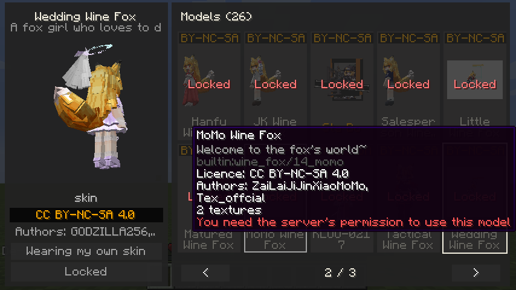

Verificado: `ModelServerTest` (nós, curingas, grant, modelo livre por nome, nó concedido depois libera só aquele
modelo e só para aquele jogador, nó retirado volta para a própria skin para todos, `/futura3d set` vence),
`MessageCodecTest`, `ModelAccessTest`, e o harness `connect` contra um servidor dedicado real: como operador nada
bloqueado, depois de `/deop` o mesmo cliente recebe a lista nova em até 5 s, o Wedding Wine Fox fica bloqueado e o
pedido é recusado, o Steve (livre) é aceito. **A checar**: no Crucible com LuckPerms (nó dado/retirado a um grupo
com o jogador online, `lp user ... permission set futura3d.playermodel.<modelo>`), e o custo da checagem com muitos
jogadores e modelos (uma chamada `hasPermission` por modelo por jogador a cada 5 s, mais as dos curingas).

## Pesca: o pescador acompanha a vara (`player.fishing`)

Não vem do upstream. O YSM só tem `hold_mainhand:fishing` (uma pose parada com a linha fora) e `swing:fishing_rod`, um
golpe genérico que arma o braço para trás e só arremessa aos 0,37 s, quando a boia já saiu no clique: era o
"lançamento desincronizado" da vara do AkashicFishing. Agora o ato inteiro de pescar é uma máquina de estados
(`anim/FishingStates`, Java puro, testado) que toca `fishing:<fase>` num controlador próprio, `player.fishing`, entre
`use` e `passenger`; um modelo pode trocá-lo por um controlador Bedrock de mesmo nome, ou trazer clipes próprios com
os mesmos nomes. Todo modelo cai no conjunto do modelo padrão (`default/animations/fishing.animation.json`, CC0, feito
para o futura3d), que só mexe nos ossos que todo modelo YSM tem.

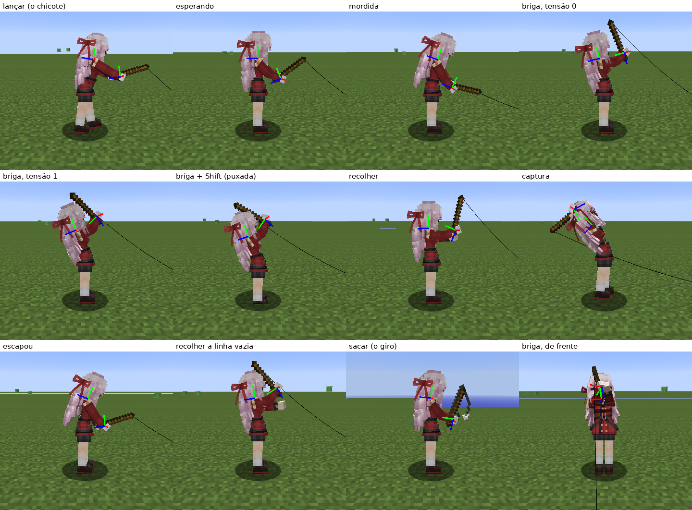

| Fase | Clipe | Quem vê | O que o corpo faz |
|---|---|---|---|
| `draw` | uma vez, 0,8 s | o cliente: a vara chega à mão | a vara sai para o lado e dá um giro inteiro no punho, a cabeça acompanha |
| `cast` | uma vez, 0,8 s | o cliente: o golpe com a linha recolhida, ou a boia aparecendo sem golpe (um plugin relançando) | armada rápida por cima do ombro direito com as duas mãos, o chicote aos 0,14 s (quando a boia sai) com o peso indo para o pé da frente, a vara apontando para a água |
| `wait` | laço, 4 s | o cliente: a linha fora | as duas mãos na vara, a ponta balança devagar, de vez em quando o punho confere a linha; o tronco e a cabeça ficam com o `main` (respirar, andar, agachar) |
| `bite` | uma vez, 0,7 s | o servidor (`mordida`) | a ponta é puxada para a água e o corpo junto, as sobrancelhas pulam, um tranco de volta, os punhos sobem para a briga |
| `fight` | laço, 1,6 s | o servidor (`briga`) | inclinado para trás, vara alta; o peixe corre de um lado para o outro (tronco e ponta seguem), dois trancos por volta. A tensão inclina mais, levanta a vara e alarga tudo; perto do limite os braços tremem. Cada Shift (a tecla do minigame) é uma puxada para cima e para trás |
| `reel` | laço, 0,6 s | o servidor (`recolher`) | a vara alta na direita, a esquerda gira a manivela; a ponta acena a cada volta e desce com a tensão |
| `catch` | uma vez, 1,5 s | o servidor (`captura`) | agacha para carregar, puxão enorme por cima da cabeça com um pulinho (a cabeça segue o peixe voando), aterrissa, o punho esquerdo sobe duas vezes, a vara descansa baixa |
| `escape` | uma vez, 1,4 s | o servidor (`escapou`) | a linha afrouxa, o corpo tropeça para trás com a vara subindo, os ombros caem, a vara pende, a cabeça balança |
| `retrieve` | uma vez, 0,45 s | o cliente: a linha volta sem peixe (o clique, ou a boia sumindo) | um piparote do punho que levanta a ponta |

Como as fases andam:

* **Sincronia do lançamento**: o golpe com a vara começa o `cast` na hora (para o jogador local, o clique; a boia
  chega uma ida e volta depois e é o mesmo lançamento por até 2 s, `CAST_GRACE_TICKS`). Para os outros, o golpe e a
  boia chegam juntos: um golpe no mesmo quadro em que a boia aparece é o lançamento (vale a linha de antes do quadro).
  `swing:fishing_rod` não toca mais com a vara na mão (`FishingStates.claimsSwing`); sem o clipe `fishing:cast`, o
  antigo volta.
* **Recolher**: um golpe com a linha fora começa o `retrieve` na hora (a boia some um pouco depois e é o mesmo); na
  briga, um clique não faz nada (o AkashicFishing trava a linha).
* **O servidor** (o que só ele sabe) chega por dois estados externos que o Kunftig diz a partir do canal `kunftig:rod`
  (`FuturaModels.FISHING_STATE`/`FISHING_TENSION`, API 4): `fishing.state` com os nomes do `KunftigRods`
  (`mordida`, `briga`, `recolher`, `captura`, `parada`), os do `RodMotion` do AkashicFishing (`briga_erro`, que
  segue a briga sem recomeçar, `fuga`, `captura_rara`, `captura_mitica`) ou `escapou`, e os nomes em inglês;
  `fishing.tension` de 0 a 1. Limpar e pôr de novo recomeça (uma segunda mordida). `parada` no meio da briga com a
  linha ainda fora é a fuga (o AkashicFishing manda `parada` quando o peixe escapa de uma vara sem o estado `fuga`);
  com a linha recolhida, a briga só acabou. Quem chega perto no meio de uma briga entra direto nela; um estado que
  toca uma vez não é tocado atrasado.
* **Clipes que tocam uma vez** passam a vez no fim (transição incluída): para `wait` com a linha fora, senão para
  `ready` (nada nosso: o `hold`/`main` de sempre). Trocar de item, dormir: `none`.
* **Transições** por fase (`Phase.transitionSeconds`): 0,03 s na mordida, 0,04 s no lançamento, 0,3 s para a espera.
* **Molang** (nosso): `ctrl.fishing_animation` (o clipe da fase, ou `''`), `ctrl.fishing_tension` (a tensão, suavizada
  para um degrau de centésimo não dar tranco) e `ctrl.fishing_heave` (0 a 1, a puxada do Shift, suavizada, só na
  briga). As expressões dos clipes usam essas três, `q.anim_time` e `q.life_time`.
* **Shift na briga**: o AkashicFishing usa Shift como tecla do minigame; agachar a cada aperto jogaria o corpo no
  agachamento fundo do modelo e de volta. Durante a briga o `main` troca `sneaking`/`sneak` por `idle`/`walk`
  (`FishingStates.braced`) e o Shift vira só a puxada da vara. Os controladores Bedrock dos modelos continuam vendo
  `ctrl.sneaking`.
* **API 4** (`api/FuturaModels`): `FISHING_STATE`, `FISHING_TENSION` e `fishingPhase(jogador)` (`none`, `ready`,
  `draw`, `cast`, `wait`, `bite`, `fight`, `reel`, `catch`, `escape`, `retrieve`).

**A vara reta e as varas 3D** (depois do primeiro teste no TEOF, com as duas mãos juntas a vara saía inclinada para o
lado):

* O `display` de terceira pessoa das 16 varas 3D do AkashicFishing tem `[80, 35, 0]`: os 35° em Y existem para o braço
  do bíped, que os clipes `braco` do pack giram −55° em Y com a linha fora; no bíped a vara sai reta. O modelo segura
  com os próprios clipes, então a vara saía 26° para a direita (conta feita com a cadeia inteira: a pose, a
  conversão do locator para a mão vanilla, o `display`). O Kunftig agora desenha a vara na mão de um modelo sem esse
  giro (`terceira_pessoa_modelo` no manifesto, ou o `terceira_pessoa` sem o Y).
* `anim/RodAim`: depois da pose, gira o `RightHandLocator` em volta da vertical do modelo para a vara apontar reta
  (ou reta para trás, quando ela inclina para trás), qualquer que seja o braço do modelo: cada braço vira para dentro
  para as mãos se encontrarem, e cada modelo tem os seus braços. Só tira o desvio lateral; a subida e o giro da vara
  continuam os do clipe. Vale nas fases de pesca e com a vara na mão sem linha (`Phase.straight`); não vale no sacar e
  nas reações em que a vara cruza o corpo. Teste: `default`, `misc/1_alex`, `wine_fox/13_matured` e
  `wine_fox/22_elf`, esperando, brigando, recolhendo e parados.
* **Para onde o jogador olha** (segundo teste: "não parece 100% reta"): no 1.7.10 o corpo parado fica até 75° atrás
  da cabeça (`renderYawOffset`), então a vara reta em relação ao corpo saía torta em relação à câmera (medido no
  harness: corpo −171,9°, cabeça −180°; depois de virar, corpo −132°). Nas fases de pesca com a vara para a frente
  (`Phase.aimsAtLook`: lançar, esperar, mordida, briga, recolher...) a vara aponta para o olhar
  (`PlayerAnimator.netHeadYaw`, até 75°); com a linha fora (`Phase.facesLine`) o `UpBody` gira metade disso, e a
  cabeça desconta o giro, para o tronco acompanhar a vara. Medido no harness `modelfishing` do Kunftig: esperando,
  vara −180,0° com a cabeça em −180°; virando a cabeça para 150°, a vara vai para 150,2° (o corpo continua em
  −171,9°). Teste: `withTheLineOutTheRodPointsWhereThePlayerLooks`. **A verificar** no TEOF.
* As animações próprias das varas 3D: o `sacar` gira a vara sozinho (o `fishing:draw` não gira mais a mão: dava
  giro duplo); o `lancar` foi feito para o bíped, que arma antes (a vara chicoteia para trás aos 0,37 s e para a frente
  aos 0,5 s): num modelo o Kunftig começa o `lancar` 0,3 s adiantado, e os chicotes caem na armada e no arremesso do
  modelo (que arremessa com a boia); a `briga` já inclina a vara 11 a 18° para trás, então a briga do modelo deixa a
  vara um pouco antes da vertical.
* **Reações** das varas (as skins Sanrio do AkashicFishing, `docs/INTERACOES.md` de lá), que o servidor manda como os
  estados da briga: `carinho` → `fishing:pet` (a vara junto ao peito, a mão livre faz carinho três vezes), `inspecionar`
  → `inspect` (a vara de pé diante dos olhos enquanto gira sozinha), `ociosa` → `lazy` (em laço: a vara no ombro, um
  cochilo e um bocejo), `encontro` → `greet` (aceno com a mão livre), `rivalidade` → `rival` (inclinado, a vara
  apontada como espada, a mão na cintura), `comemoracao` → `celebrate` (dois pulinhos de braços para cima). Cada clipe
  dura o mesmo que a animação da vara; `parada` encerra uma reação; Shift com clique esquerdo não é mais lançamento (só
  a boia aparecendo lança).

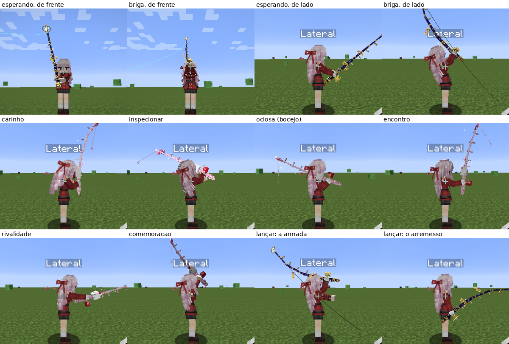

Os clipes saem de `tools/fishing_animations.py` (`--check` confere): as poses-chave ficam em listas legíveis, com a
convenção dos ossos e uma conta medida no harness para o ângulo da vara (cerca de `0,45 × −(braço + antebraço) −
RightHandLocator + 55` graus acima do horizonte). Abrem no Blockbench como qualquer animação Bedrock.

Harness: `only fish` (`dev/RenderHarness.fishingSteps`): um segundo jogador com a vara, visto de lado, a boia presa
três blocos à frente, cada foto alguns ticks depois do começo da fase (o log diz a fase a cada tick). Testes:
`FishingStatesTest` (nomes, a máquina de estados inteira com captura, fuga, recolher, relançar, a mordida de novo, o
golpe que chega com a boia, o armazém recriado, a suavização, o modelo tocando a vara, a tensão e o Shift mexendo na
pose, todos os modelos caindo no conjunto padrão) e `BuiltinMolangTest`, que compila cada expressão dos clipes.

**A checar** em jogo de verdade (o harness é software e os tempos das fotos andam um ou dois ticks):

* Num servidor com o AkashicFishing, o Kunftig e dois clientes: a mordida, a briga com a tensão e a captura vistas
  pelo próprio pescador e pelo outro; o lançamento do jogador local com ping alto (a armada dura até a boia chegar).
* Com a vara 3D do Kunftig na mão: a pose do corpo junto com a animação da vara (as duas tocam em paralelo, sem
  sincronia quadro a quadro), a linha saindo da ponta nas poses de captura e de puxada.
* Nos modelos com esqueleto diferente do padrão (os clipes giram `RightHandLocator`; num modelo que segura a vara em
  outro ângulo, a ponta pode sair mais alta ou mais baixa).
* Pescando de barco (os clipes de uma vez mexem nas pernas por um instante) e andando durante a briga.
* As reações com o servidor de verdade (o carinho, a ociosa que acaba quando o jogador se mexe, o encontro entre dois
  jogadores) e a vara reta em modelos com braços muito diferentes do padrão.
* A câmera em primeira pessoa segue a altura da cabeça do modelo (`view_locator_camera`, etapa 6): o pulinho da captura
  e a inclinação da briga a movem uns 0,1 bloco, suavizado. Conferir se incomoda.

## Elytra do Et Futurum Requiem

O EFR (a "backlytra") põe a elytra do 1.9 no bíped vanilla: o planar no jogador (`etfu$isElytraFlying`, por mixin),
a inclinação do corpo no `RenderPlayer.rotateCorpse` e as asas na passada da armadura (`LayerBetterElytra`, no
`RenderLivingEvent.SetArmorModel`). Quem é desenhado com modelo pula as duas: o jogador planava em pé, na pose de
"voando" (o voo dos outros jogadores é estimado pelo movimento, e quem plana parece voar) e sem asas.

`client/ElytraBridge` lê o EFR por reflexão (nenhum dos dois precisa do outro; conferido contra o EFR 2.6.2):

* `isFallFlying` vem do EFR, e planar desliga o voo estimado e a natação: toca o `elytra_fly` do modelo. Esse clipe
  deita o corpo sozinho (`Root` 90°), como no upstream, cujo `setupRotations` é o da entidade viva, sem a inclinação de
  planar do jogador; a inclinação do EFR não é aplicada (deitaria duas vezes).
* As asas são a camada do próprio EFR (`LayerBetterElytra.doRenderLayer`: textura, a capa de quem tem uma, o brilho
  de encantamento e os ângulos que o EFR suaviza) desenhada no grupo `ElytraLocator`, como o
  `CustomPlayerElytraLayer` do upstream (locator escondido esconde as asas), no referencial do corpo do bíped
  (`Rz(180°)`, sem os 2 px para trás que o EFR soma, porque o locator já fica nas costas). Modelo sem o locator (5 dos
  24 embutidos: `wine_fox/05_magical`, `06_hanfu`, `08_sta`, `21_saint`, `22_elf`): as asas no `UpBody`, onde o modelo
  padrão tem o locator (11 px acima do pivô, 2 px para trás), em vez de sumirem.
* `query.has_elytra` e `ysm.elytra_rot_x/y/z` (graus) passam a valer: os ângulos das asas que o EFR guarda no jogador.
* Primeira pessoa: planando, a câmera fica na altura vanilla (a cabeça deitada não é altura de olho).

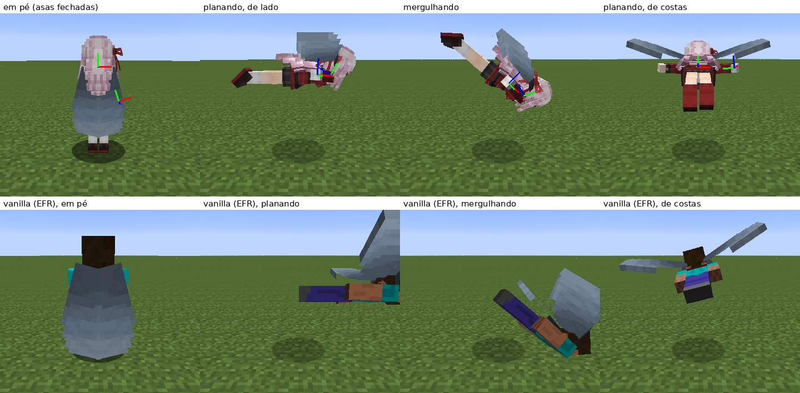

Harness: `only elytra` (`dev/RenderHarness.elytraSteps`; o `etfuturum-2.6.2-dev.jar` em `run/client/mods`): um segundo
jogador com a elytra, em pé, planando de lado, mergulhando e de costas, cada um ao lado do vanilla, e um modelo sem o
locator. **A checar** em jogo: a versão do EFR do TEOF (os nomes lidos são os do 2.6.2), o próprio jogador planando
em terceira pessoa e outro jogador num servidor (o planar dele chega pelo `DataWatcher` do EFR), a elytra no slot do
Baubles Expanded, e com o Akashic Player Backport (que também lê o planar do EFR para o bíped).

## Varas e peixes 3D do Kunftig nos modelos (API 5)

Conferido no harness do Kunftig (`modelrods`: o jar de dev do futura3d e o pack de varas e peixes 3D do
AkashicFishing, da branch `claude/kind-ride-ts9apr`): as **16 varas 3D saem com a textura certa** na mão do modelo,
igual ao bíped (a diferença é só o ângulo, que é o da pose do modelo, e um tom um pouco mais claro pela luz). A
`vara-akashica` dourada no estágio 6 troca de cor de propósito: as texturas `_m6_0` a `_m6_7` são um ciclo de cores.

Os **peixes 3D** estavam errados: o tucunaré e o peixe-palhaço não apareciam (ficavam dentro do corpo) e o pirarucu
gigante pendia para o chão. As faixas de tamanho do pack mexem no braço do bíped (`braco`/`braco_esquerdo`: o braço à
frente, as duas mãos, acima da cabeça) e o `display` do peixe é posto para esse braço; o modelo, com o braço parado,
segurava o peixe num braço que não estava lá. Agora o Kunftig passa a mesma pose para o modelo:

* `FuturaModels.setArmPose(jogador, direito, esquerdo)` (API 5): a rotação do braço a partir de pendurado, em
  radianos, na convenção do `ModelBiped`; troca a rotação animada do `RightArm`/`LeftArm`, e os locators da mão
  seguem. Vale por um quarto de segundo (`anim/ArmPoses`): quem para de mandar devolve o braço à animação na hora.
  A conversão: o bíped é desenhado sob `scale(-1, -1, 1)`, então x e y giram ao contrário dos nossos e z igual (a
  mesma regra do olhar da cabeça, `headPitch = -pitch`, `netHeadYaw = -yaw`).
* O Kunftig manda em `RenderPlayerEvent.Pre`, só para modelos segurados que não são vara (as varas têm os clipes de
  pesca do modelo).

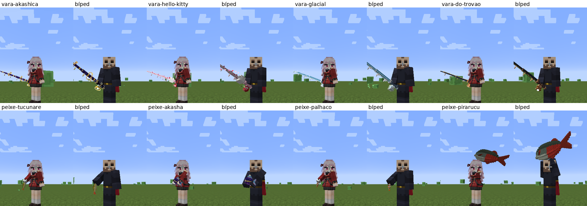

**A checar** em jogo: os peixes das outras faixas e qualidades, andando com o peixe na mão (o braço fica na pose da
faixa, sem o balanço de andar), e modelos com braços muito diferentes do padrão.

## Armadura no modelo padrão e no Steve/Alex (`armor/ArmorFit`, `client/render/ArmorRenderer`)

O upstream não desenha armadura nos modelos (o `CosmeticArmorCompat` dele só serve às condições `armor`). Aqui a
armadura vestida aparece no **modelo padrão** (`builtin:default`) e no **Steve/Alex** (`misc/2_steve`, `misc/1_alex`,
o visual de quem não escolheu modelo); os modelos customizados continuam sem armadura.

* As quatro passadas são as do `RenderPlayer.shouldRenderPass` e do `RendererLivingEntity.doRender`: a textura do
  `RenderBiped.getArmorResource` (com o `getArmorTexture` do Forge), a cor do couro tingido e o `overlay`, o brilho
  de encantamento, o modelo de 1 px (capacete, peitoral, botas) e o de 0,5 px (calças).
* **Armadura do bíped vanilla** (ferro, ouro, diamante, couro, malha, a de taumium e a do vazio do Thaumcraft e toda
  armadura que só troca a textura): cada caixa do bíped é cortada onde o modelo dobra e cada corte é esticado sobre a
  caixa de um osso (`ArmorFit`): a cabeça no `Head` (no padrão, uma caixa que cobre o cabelo), o tronco no
  `UpperBody`, os braços no braço e no antebraço, as pernas na coxa e na canela, e no padrão o fim da bota no pé (com
  o dedo). Os cortes levam as linhas certas da textura (`ArmorBoxes`, mesma disposição do `ModelBox`: cantos,
  espelho, ordem das faces), então a armadura dobra no cotovelo e no joelho com a animação.
* **Armadura com modelo próprio** (`Item.getArmorModel`: a armadura da fortaleza, os mantos e os óculos da revelação
  do Thaumcraft, as dos cultistas): o modelo roda o próprio `render` uma vez sem escrever nada (é lá que a fortaleza
  escolhe a máscara, os óculos e as peças do conjunto) e depois cada parte do bíped, com as peças penduradas nela, é
  desenhada inteira no osso do primeiro corte (o braço inteiro no braço, a perna inteira na coxa), sem a pose do
  bíped. Essa armadura não dobra no joelho e no cotovelo; peças que um modelo desenha fora das partes do bíped não
  aparecem.
* **Cosmetic Armor Reworked** (1.7.10, `lain.mods.cos`; `client/CosmeticArmor`, por reflexão): o item cosmético de
  um slot aparece no lugar do vestido, e um slot marcado "mostrar pele" não mostra nada; com a tecla do mod que
  esconde a armadura cosmética, aparece a vestida. Vale também para as condições `armor` dos modelos e para o
  capacete-bloco (abóbora, cabeça) na cabeça de todos os modelos. O mod já troca a armadura durante o desenho do
  jogador (`RenderPlayerEvent.Pre` a `Post`); a leitura dá a mesma resposta ali e fora dele.
* Não é desenhado: o vermelho do dano sobre a armadura, e o `RenderPlayerEvent.SetArmorModel` não é disparado (mods
  que desenham a própria armadura por esse evento, como as asas do EFR, já têm a sua ponte ou ficam de fora).

Harness: `only armor` (`dev/RenderHarness.armorSteps`): um segundo jogador de ferro de frente, de lado e de costas,
um conjunto misto, andando e agachado, no padrão, no Steve, no Alex e no bíped vanilla para comparar, e um modelo
customizado (sem armadura). Com `-PthaumcraftArmor` (`dependencies.gradle`, só desenvolvimento) o Thaumcraft 4.2.3.5 e
o Baubles vêm do CurseMaven desobfuscados, para as armaduras da fortaleza, dos mantos e de taumium; com um jar de dev
do Cosmetic Armor Reworked em `run/client/mods` (compilado das fontes da branch `1.7.10` do mod), o slot cosmético.
Testes: `ArmorFitTest` e `ArmorBoxesTest`. **A checar** em jogo: a versão do Cosmetic Armor Reworked do TEOF (os
nomes lidos são os da `1.7.10-v7`), outros mods de armadura com modelo próprio, e a armadura com o Angelica.

## Fases

1. **Prova:** ler um modelo CC0 embutido, assar em display lists, desenhar no lugar do jogador local; medir ms/quadro
   com 1, 10 e 30 cópias, com e sem Angelica.
2. **Animação:** clips, keyframes, pilha de controladores, mistura (os `parallel*` somam rotação), estados `main`,
   Molang, `ysm.second_order`/`first_order`, `ysmGlow`.
3. **Jogador completo:** itens nos locators, primeira pessoa (`arm.json`, `Background`), escala, emotes `extra`.
4. **Servidor:** catálogo, fragmentos, cache, seleção, autorização, roleta e seletor.
5. **Extras:** controladores Bedrock, funções `@evento`, sons Vorbis, `v.roaming`, SlashBlade e Touhou Little Maid.
6. **Paridade e carregador nativo:** `.ysm` legado em memória, projéteis e veículos, Opus, câmera pelo `ViewLocator`,
   nomes traduzidos, ordem dos translúcidos, validação contra o YSM 1.20.

O critério de "emulado" é paridade lado a lado com o YSM 1.20 nos mesmos modelos abertos: mesma pose em cada estado,
mesma física, mesmo piscar, emotes, brilho e sons. Animações de mods que não existem na 1.7.10 (TaCZ, Carry On,
ParCool, SWEM) nunca disparam.
