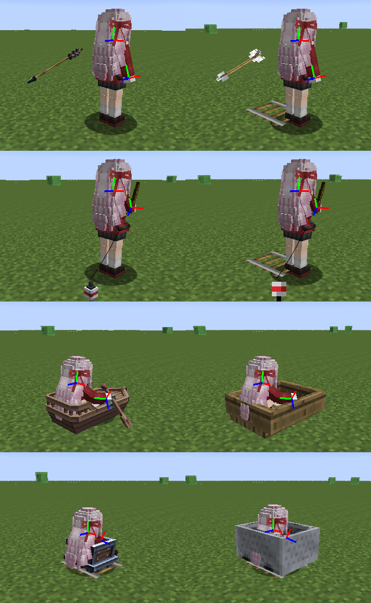

# Etapa 6, item 2: modelos de projéteis e veículos

Um modelo pode trocar projéteis e veículos por geometria própria, declarada no `ysm.json`: `files.projectiles` e
`files.vehicles` (listas, ou objetos cuja chave é o `match`, de `ReplacedModelFiles`: `match`, `model`, `animation`,
`controller`, `texture`) e o antigo `files.arrow` (uma entrada só, para a flecha). Os POJOs já liam isso desde a fase 1;
agora o carregador monta cada alvo, o cliente anima e desenha, e o vanilla volta sempre que algo falta ou falha.

## Mapa do upstream

| Upstream (`com.elfmcys.ysm`) | Aqui |
|---|---|
| `format/parser/RawModelAssembler.writeReplacedModels/writeReplacedModel` | `model/ModelLoader.addReplacement`, `model/ReplacementTarget` |
| `util/ModelIdUtil.getEntityIdMatch` (ids do `match`) | `ReplacementTarget.entityId` |
| `model/catalog/client/ClientCatalogManager.findRenderTarget` | `LoadedModel.projectile/vehicle`, `client/ClientReplacements.projectile/vehicle` |
| `model/catalog/content/DefaultAnimationKey.domain`, `ModelRenderTargetLoader.prepareSet` (animações do default por trás) | `ReplacementTarget.domain`, `anim/DefaultAnimations.replacementLibrary` |
| `client/controller/collections/ProjectileControllerCollection`, `VehicleControllerCollection`, `SingleControllerDiscovery`, `ParallelControllerDiscovery` | `anim/EntityAnimations` (o que existe), `anim/EntityAnimator` (a pilha por entidade) |
| `client/animation/predicate/ProjectileMainPredicate`, `VehicleMainPredicate`, `VehicleMovePredicate`, `VehicleRidePredicate`, `ParallelPredicate` | `EntityAnimator` |
| `expression/host/builtin/*` com sujeito projétil/veículo | `anim/EntityMolangContext` |
| `capability/Projectile*Capability`, `Vehicle*Capability`, `event/CapabilityEvent.onProjectileSetOwner/onVehicleSetModel`, `mixin/ProjectileEntityMixin`, `mixin/ServerPlayerMixin` | `client/EntityReplacements` (o dono é achado no cliente) |
| `mixin/AbstractArrowEntityMixin` (`inGround`, `shootItemId`) | `mixin/mixins/EntityArrowAccessor`; o item do atirador lido no primeiro desenho |
| `mixin/client/EntityRenderDispatcherMixin`, `client/renderer/replace/*`, `geckolib3/geo/GeoProjectilesRenderer`, `GeoEntityRenderer`, `client/renderer/CustomProjectileRenderer`, `CustomVehicleRenderer` | `mixin/mixins/RenderArrowMixin`, `RenderFishMixin`, `RenderBoatMixin`, `RenderMinecartMixin`, `RendererLivingEntityMixin`; `EntityReplacements.draw` |
| `util/RenderUtil.adjustPassengerPosition` | `EntityReplacements.passengerY`, chamado de `PlayerModels.render` |
| `client/controller/VehicleOriginController` (rotação do Immersive Aircraft e Simple Planes) | Não vem |
| `ProjectileModelState`/`VehicleModelState` do protocolo, NBT do dono na entidade | Não vem (ver abaixo) |
| `ClientConfig.DISABLE_PROJECTILE_MODEL/DISABLE_VEHICLE_MODEL` | `EntityReplacements.setEnabled` (só por código; sem opção de configuração ainda) |

## Carregamento (`model/`, Java puro, testado)

`ModelLoader` lê, depois do jogador, os projéteis na ordem do manifesto, o `files.arrow` depois deles e então os
veículos, como `writeReplacedModels`. Cada alvo vira um `ReplacementTarget`: geometria assada com o `GeoBaker`,
arquivo de animação (opcional, lido com o `merge_multiline_expr` do modelo), controladores Bedrock do arquivo
`controller` (opcional, por nome), caminho da textura e o `match`. O id do upstream (`projectile/0000`) sai do índice;
uma entrada sem `match` é pulada mas gasta o índice, como lá.

Qual alvo troca uma entidade: o primeiro alvo do tipo, na ordem do manifesto, que tem textura e cujo `match` contém o
id da entidade (`findRenderTarget`). O `match` segue o `ResourceLocation.tryParse`: sem namespace é `minecraft:`
(`arrow` = `minecraft:arrow`), maiúsculas ou espaços invalidam a entrada.

As animações de um alvo têm por trás as do alvo do modelo default com a mesma lista de `match` (o domínio do
`DefaultAnimationKey`): a flecha de qualquer modelo com `match: ["minecraft:arrow"]` herda o `air`, `water`... e o
`parallel0` (arco ou besta pelo `ysm.shoot_item_id`) da flecha do default quando não os tem.

`net/ModelLimits.checkModel` soma ossos, cubos e animações dos alvos aos do jogador. O servidor não muda: os arquivos
dos alvos são arquivos do modelo, o `ModelRepository` já os lê e manda (teste com o default copiado para a pasta do
servidor e remontado do lado do cliente a partir dos arquivos transferidos).

## Animação (`anim/`, Java puro, testado)

`EntityAnimations.compile(modelo, alvo)` uma vez por alvo; `new EntityAnimator(anims)` por entidade;
`update(snapshot, ticksExisted + partialTicks)` e `pose()` a cada quadro. As entradas vêm de um `EntitySnapshot`
(posição, movimento, rotação, chão, água, fogo, flecha cravada, montaria, vida e `moveForward` de montaria viva,
`shootItemId`, tempo e clima).

| Pilha | Controladores (transição de entrada) |
|---|---|
| Projétil | `projectile.pre_main`\*, `main` (0,1 s), `post_main`\*, `parallel_N` (0, rotação somada) |
| Veículo | `vehicle.pre_parallel_N`, `pre_main`\*, `main` (0,1 s), `move` (0,1 s), `ride` (0,1 s), `post_main`\*, `parallel_N` (0, rotação somada) |

Como o `SingleControllerDiscovery`: `pre_main`, `main`, `move`, `ride` e `post_main` só existem se o alvo declara o
controlador Bedrock, o modelo tem a função `<categoria>_ctrl_<nome>` ou uma das animações da lista não está vazia
(`main` do projétil: `water`, `ground`, `fly`, `fire`; do veículo: `water`, `ground`, `fly`; `move`: `forward`, `idle`;
`ride`: `has_ride`, `not_ride`). Os `parallel_N` são os de `^<base>[0-7]$` (não multi). Cada um é híbrido: um
controlador Bedrock de mesmo nome no arquivo `controller` substitui o predicado codificado.

Predicados iguais ao upstream: projétil na água `water`, pegando fogo `fire`, flecha cravada `ground`, senão `air` (o
upstream lista `fly` na descoberta mas toca `air`; mantido); veículo na água `water`, no chão `ground`, senão `fly`;
`forward` acima de 0,05 bloco por tick na horizontal (`motionX/Z`), senão `idle`; `has_ride` com alguém montado.

Molang (`EntityMolangContext`): `query.*` de entidade (`anim_time`, `life_time`, `ground_speed`, `is_on_ground`,
`is_in_water`, `is_on_fire`, `has_rider`, `position`, `position_delta`, `vertical_speed`, `yaw_speed`,
`body_y_rotation` de montaria viva, `health`...), `ysm.shoot_item_id`, `ysm.ground_speed2`, `ysm.yya`, `ysm.fps`,
`ysm.weather`, `ysm.is_open_air`, atributos de osso, física `first_order/second_order`, sons, `ysm.defer`, `ctrl.*` de
controlador codificado e `fn.*` (as funções do modelo). Os nomes de jogador (itens, armadura, `ctrl.idle`...) dão 0,
como os builtins do upstream para um sujeito que não é jogador; `ysm.sync` e partículas não fazem nada. Os eventos
`player_init`/`player_update` não rodam em projétil nem veículo (o upstream só os dispara em humanoides).

**`v.roaming`** (papel de consumidor do upstream): o projétil recebe uma cópia das variáveis roaming do atirador no
primeiro desenho (o upstream as grava no tiro); o veículo copia as do jogador montado a cada quadro enquanto ele está
montado (o upstream as recebe do servidor, que encaminha as do passageiro). O que o projétil ou veículo escreve em
`v.roaming` fica nele. Exemplo nos embutidos: `wine_fox/18_wedding` escreve `v.roaming.wheelRocate` num
`move@player_update` e o carro `GMA_T.50` gira as rodas com ela.

## Desenho (cliente)

Quem dá o modelo: no upstream o servidor grava na entidade o modelo do dono (o atirador quando o dono é definido; o
primeiro passageiro jogador do veículo, atualizado enquanto ele monta, e mantido depois que ele desce) e manda aos
clientes. Aqui o cliente acha o dono sozinho:

* flecha: `EntityArrow.shootingEntity` (a 1.7.10 manda o atirador no pacote de spawn); o modelo e o item na mão são
  fixados no primeiro desenho;
* boia: `EntityFishHook.field_146042_b` (o pescador; o upstream troca a boia por `FishingHookRendererReplace`). A
  linha continua a da fase 3c (sai da mão do modelo); só os `addVertexWithUV` da boia vanilla são pulados;
* barco, carrinho, porco, cavalo (e montaria viva de mod): o jogador em `riddenByEntity`; quando ele desce, a entidade
  guarda a chave do modelo dele, como o upstream guarda o modelo no veículo.

Ids da 1.7.10 para os do `match` (`model/LegacyEntityIds`, testado): `Arrow` `minecraft:arrow`, `Boat`
`minecraft:boat`, `MinecartRideable` `minecraft:minecart` (e `chest_minecart`, `furnace_minecart`...), `Pig`
`minecraft:pig`, `EntityHorse` pelo tipo (`horse`, `donkey`, `mule`, `zombie_horse`, `skeleton_horse`), a boia
`minecraft:fishing_bobber`, o ovo `minecraft:egg`; entidade de mod `Mod.NomeDaEntidade` vira `mod:nome_da_entidade`,
como o `PlayerInputsAdapter` já nomeia veículos para as condições `vehicle$`.

Ganchos: injeção no começo (`HEAD`, cancelável) de `RenderArrow.doRender`, `RenderBoat.doRender`,
`RenderMinecart.doRender` e `RendererLivingEntity.doRender` (montarias vivas; jogadores nunca), mais duas peças no
`RenderFishMixin`. Injeção em `HEAD` convive com outros mods que injetam no mesmo método (um `@Redirect` não). Sombra e
fogo seguem com o `RenderManager`; numa montaria viva o nome continua (`passSpecialRender`), e o `RenderLivingEvent.Pre`
não dispara (o upstream desenha veículos sem os eventos de entidade viva).

Posição e rotação, do `GeoProjectilesRenderer`/`GeoEntityRenderer` em GL da 1.7.10:

* projétil: `T(x, y − yOffset, z) · Ry(yaw − 90°) · Rz(pitch) · S(0,7)`, com o yaw e o pitch interpolados da entidade
  (a mesma convenção do `RenderArrow` da 1.7.10 e do `ArrowRenderer` da 1.20); a boia com pitch 0, como o upstream
  força;
* veículo: `T(x, y − yOffset, z) · Ry(180° − yaw) · S(0,7)`, o yaw do `EntityRendererReplace.getYaw`: corpo
  interpolado da montaria viva (com a regra do sentado sobre outra montaria), no carrinho o ângulo do trilho
  (`func_70489_a`/`func_70495_a`, as `getPos`/`getPosOffs` da 1.20), senão o yaw do renderizador;
* 0,7 fixo, como `CustomProjectileEntity/CustomVehicleEntity.getWidthScale/getHeightScale`.

Diferente, de propósito:

* **`y − yOffset`**: na 1.20 a posição da entidade é o fundo da caixa; na 1.7.10 o barco e o carrinho têm `posY` meia
  altura acima dele (0,3 e 0,35). O modelo vai no fundo da caixa, onde o upstream o põe.
* **Yaw do barco + 90°**: o barco da 1.7.10 guarda em `rotationYaw` o ângulo `atan2(dz, dx)` de `prev − pos` (aponta
  para trás, no eixo x), não o yaw de entidade; o da 1.20 é o yaw de entidade (frente = direção do remo). Somar 90°
  põe a proa do modelo no sentido do movimento e da visão do piloto (conta feita: frente 1.7.10 = −(cos y, sin y),
  frente 1.20 = (−sin y', cos y'), logo y' = y + 90°; o barco colocado olhando para y vira y' = y, como na 1.20).
* **Passageiro**: o jogador num veículo trocado é desenhado com os pés no fundo do veículo, meio bloco abaixo
  (`adjustPassengerPosition`: `−ridingOffset − myRidingOffset − 0,5`). Só jogadores (os únicos desenhados por nós);
  um mob montado num veículo que ficou trocado depois que o jogador desceu continua na posição vanilla. A sombra e o
  nome do jogador ficam onde o vanilla os põe.
* **Dono dos arremessáveis pelo servidor (protocolo 3)**: o cliente 1.7.10 não sabe quem jogou os arremessáveis
  (`EntityThrowable`: bola de neve, ovo, pérola, poção, frasco de experiência) nem as bolas de fogo (o `getThrower()`
  só funciona no servidor e o pacote de spawn não traz o dono). O servidor manda `S_PROJECTILE_OWNER` (id da entidade,
  UUID de quem jogou) no `PlayerEvent.StartTracking` dela, logo depois do pacote de spawn, só a clientes 3; o cliente
  guarda até o primeiro desenho (`EntityReplacements.setThrower`) e espera até 5 ticks por ele antes de decidir que
  fica vanilla. Desenho: `RenderSnowballMixin` (bola de neve, ovo, pérola, poção, frasco) e `RenderFireballMixin`
  (bola de fogo e a pequena), com a mesma colocação da flecha. O foguete continua vanilla (na 1.7.10 ele não tem dono
  nem no servidor) e o tridente não existe. Uma flecha cujo atirador estava fora do alcance de rastreio quando ela
  nasceu também fica vanilla. **A checar**: nenhum modelo embutido tem alvo para esses projéteis; só testado em
  unidade (codec, o servidor mandando só a clientes 3).
* **Memória do veículo só neste cliente**: o upstream guarda o modelo do último passageiro na entidade (com NBT) e o
  manda a quem passa a vê-la; aqui cada cliente lembra o último piloto que ele viu, enquanto a entidade existe nele
  (saiu do alcance e voltou, volta vanilla até alguém montar).
* **`files.arrow` sem `match`** casa com `minecraft:arrow`. O `writeReplacedModel` do `dev/1.20` pula alvo sem
  `match`, o que deixaria sem flecha os modelos antigos que usam esse campo (`wine_fox/02_new_year`, `07_jk`,
  `03_astronaut`); o leitor do layout 1.x do próprio upstream dá a ele o `match` `arrow`.
* **Alvo quebrado não derruba o modelo**: geometria ausente ou JSON inválido num alvo o deixa de fora (com aviso no
  log, `LoadedModel.replacementErrors`) e o resto do modelo carrega; no upstream a importação inteira falha. Textura
  ausente ou ilegível deixa o alvo inutilizável (vanilla), como o alvo sem textura do upstream.
* **Default por trás só quando existe**: o `prepareSet` do `dev/1.20` exige uma fonte de animações do default para o
  domínio do alvo e falha sem ela (um cavalo, que o default não tem, não carregaria); aqui o alvo fica só com as
  próprias animações.
* Tags de entidade (`#minecraft:...`) nunca casam (a 1.7.10 não tem).
* Falha ao animar ou desenhar um alvo (exceção) marca o alvo como quebrado até o modelo ser recarregado: daí em diante o
  vanilla desenha, como "projectile/vehicle restore host rendering on failure". Modelo ainda carregando: vanilla.
* Entidade invisível: nada é desenhado e o vanilla também não (o upstream só desenharia o contorno brilhante, que a
  1.7.10 não tem).

## Testes

65 testes novos, 454 no total (`./gradlew spotlessApply build`):

* `model/ReplacementTargetTest` (31): modelo sintético em `MemoryModelSource` com lista, objeto e `files.arrow`, entrada
  sem `match`, alvo quebrado (geometria ausente, animação inválida), alvo sem textura, ordem da busca, ids do `match`,
  domínio, ids da 1.7.10, e todos os modelos embutidos (todo alvo carrega sem erro, tem textura e casa com algum id).
* `anim/EntityAnimatorTest` (32): pilha e predicados de projétil e veículo, `main` ausente quando suas animações estão
  vazias, controladores declarados por função, cópia de roaming, Molang da entidade, flecha do default mostrando arco ou
  besta pelo item do atirador (Molang real), animações do default por trás do alvo de mesmo `match`, e todo alvo
  embutido animando 180 quadros sem NaN.
* `server/ReplacementTransferTest` (1): o servidor manda os arquivos dos alvos e o modelo remontado no cliente tem os
  mesmos alvos.
* `net/ModelLimitsTest` (+1): ossos, cubos e animações dos alvos contam nos limites.

## Resultado no harness

`futura3d-harness` com `only repl` roda os passos `repl-*` (`dev/RenderHarness.replacementSteps`): um segundo jogador
com o modelo e, ao lado, uma flecha atirada por ele, a boia da vara dele, um barco, um carrinho num trilho leste-oeste e
um cavalo (com o `wine_fox/16_tactics`, cujo cavalo é um carro) em que ele está montado, cada um trocado e depois
vanilla, vistos de um quarto. Rodado uma vez (Mesa llvmpipe, Xvfb), sem erro no log:

* a flecha do default sai no mesmo eixo e sentido da vanilla (ponta para onde ela voa, inclinada pelo pitch), na
  variante de arco (o atirador não segurava besta; a troca pela besta via `shoot_item_id` está no teste, não na foto);
* a boia vira o modelo 3D do default e a linha continua saindo da vara na mão do modelo até ela;
* o barco do default fica no eixo do barco vanilla com a proa para onde o piloto olha; o jogador senta dentro, mais baixo
  que no vanilla (o meio bloco do upstream);
* o carrinho do default (um carrinho pequeno de tábuas) fica sobre o trilho e alinhado com ele, mas à frente do jogador,
  não centrado nele;
* o cavalo vira o carro do `16_tactics`, de frente para onde o cavalo olhava, com o jogador dentro.

A imagem acima tem só o modelo default (CC0); o carro do `16_tactics` (CC BY-NC-SA) não vai para `docs/img`.

## A checar

* Lado a lado com o YSM 1.20, no jogo: orientação e altura de cada alvo embutido (flecha, boia, barco, carrinho,
  cavalo/mula e os carros dos `wine_fox`), em especial o carrinho do default, que tem a raiz girada −90° em torno de um
  pivô fora do centro e aparece deslocado para um lado do trilho, e a altura do jogador sentado (o meio bloco do
  `adjustPassengerPosition`) no barco, no carrinho e no carro.
* Movimento real (só houve fotos paradas): a flecha voando, cravando (`ground` vem do `inGround` que o cliente simula),
  caindo na água; barco e carrinho andando (`forward`/`idle` leem `motionX/Z`, que para veículo de outro jogador vêm dos
  pacotes de velocidade) e o carrinho em rampa (sem inclinação, como o upstream).
* Em servidor dedicado com dois clientes: a flecha de outro jogador, o veículo de outro jogador, o veículo depois que o
  piloto desce, e o `v.roaming` que um modelo escreve chegando ao carro (`wine_fox/18_wedding`, rodas do `GMA_T.50`).
* Sons das animações de veículo (`ysm.play_sound`/`stop_sound` saem na posição da entidade pelo `ModelSounds`).
* Convivência com Angelica e com outros mods que mexem nesses renderizadores, e o custo com muitas flechas.
* O cavalo com outros tipos (`donkey`, `mule`) e montarias de mods (o id `mod:nome` é uma aproximação).
