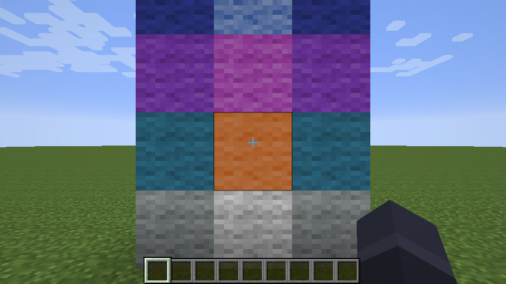
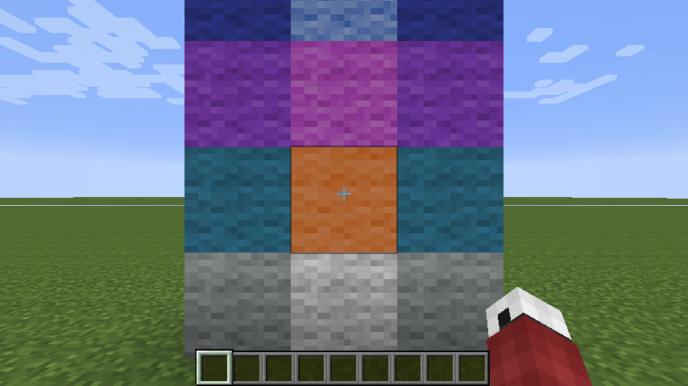
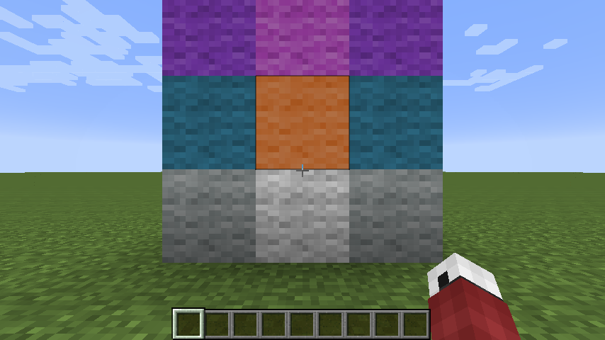

# Etapa 6: altura da câmera em primeira pessoa pelo modelo (`ViewLocator`)

Até aqui a câmera em primeira pessoa ficava na altura vanilla (PORTING.md, fase 3b). Agora, com o jogador local
desenhado com um modelo, a altura dos olhos em primeira pessoa segue o modelo: o osso `ViewLocator`, se o modelo tiver,
senão o `Head`, na pose animada do quadro (agachar, dormir, emotes, `height_scale`, raízes escaladas como o
`v.player_size` da `wine_fox/14_momo`).

## O que o upstream faz

| Upstream | Uso |
|---|---|
| `geckolib3/model/AnimatedGeoModel` | guarda os ossos `Head`, `AllHead` e `ViewLocator` pelo nome |
| `capability/PlayerAnimatableCapability.codeAnimation` | com o mod First Person Model ativo: esconde o `AllHead` e passa a altura do `ViewLocator` (o `pivot` de repouso) ou, sem ele, a do `Head` (`getPivotY`, também de repouso), vezes `heightScale` |
| `client/compat/FirstPersonCompat` | `HEAD_POS = pivotY / 16`; o deslocamento do corpo é `1,5 - HEAD_POS`, isto é, o ponto do modelo fica 24 px (1,5 bloco) acima dos pés quando a câmera está na altura vanilla (1,62) |

O upstream **não move a câmera** nem muda a altura dos olhos de jogo (`getEyeHeight` só aparece para a linha de
pesca): sem o First Person Model nada disso roda, e com ele quem se move é o corpo, por baixo da câmera fixa. Também
não há opção de configuração para isso (fica ligado sempre que o mod está instalado).

## Aqui

| Upstream | Aqui |
|---|---|
| a escolha `ViewLocator`, senão `Head`; o ponto 24 px abaixo do olho (`FirstPersonCompat`) | `geo/EyeHeight` (puro, testado) |
| `codeAnimation` + `FirstPersonCompat.setHeadPos` | `client/ViewCamera` (atualiza o animador do corpo e calcula a pose) + `mixin/mixins/EntityRendererMixin` (`orientCamera`, no `RETURN`) |
| sem opção (sempre com o First Person Model) | `view_locator_camera` em `config/futura3d/client.properties` (`client/ClientOptions`), padrão `true` |

Como funciona, por quadro, em primeira pessoa:

1. O corpo não é desenhado em primeira pessoa, então `ViewCamera` atualiza o mesmo `PlayerAnimator` que o desenho em
   terceira pessoa usa (`PlayerModels.animatorFor`), com as mesmas entradas e o mesmo relógio (trocar de vista não
   salta a animação), e calcula as matrizes dos ossos (`PoseMatrices`) numa cópia própria.
2. O modelo é posto como o `RenderPlayer.doRender` o põe para o jogador local (pés `yOffset` abaixo da posição da
   entidade da câmera; na cama, o deslocamento e o giro da cama, `ThirdPersonRenderer.placement`).
3. O ponto é o pivô do primeiro osso do grupo `ViewLocator` (`ViewLocator`, `ViewLocator2`...), ou do `Head`, depois da
   pose e da colocação. A rotação do próprio osso não move o pivô dele: olhar para cima e para baixo não mexe a câmera;
   os pais animados (agachar, inclinar, emotes) e as escalas (do modelo e dos ossos) mexem.
4. O alvo é `ponto + 0,12 - olho vanilla` (o 0,12 é `1,62 - 1,5`, a regra do `FirstPersonCompat`), limitado a
   `[-1,5; 2,5]` blocos e nunca abaixo de 0,2 bloco sobre a origem do modelo; subindo, para 0,1 bloco abaixo do primeiro
   bloco com caixa de colisão acima da câmera (sem atravessar o teto de um túnel de 2 blocos).
5. Suavização exponencial independente da taxa de quadros (constante de 0,1 s; uma pausa de mais de 0,5 s pula direto):
   sem tremor do idle, sem salto quando a pose muda.
6. No fim de `EntityRenderer.orientCamera` (depois das rotações e da translação dos olhos), `glTranslatef(0, -offset, 0)`
   move a vista no eixo vertical do mundo. O `ActiveRenderInfo`, o frustum e a neblina da água leem a matriz depois
   disso, então seguem a câmera.

**Igual ao upstream, de propósito**: a escolha do osso (`ViewLocator` antes de `Head`), a referência de 24 px (um modelo
com a cabeça em 24 px, como `misc/1_alex`, fica com a câmera vanilla), só a altura (o eixo horizontal do jogador fica),
e a altura dos olhos de jogo intocada: alcance, bloco apontado, raio do servidor e `getEyeHeight` continuam vanilla
(mudança só de render, que é o que o upstream faz também, já que ele nunca muda a altura de jogo).

**Diferente, de propósito**:

* A câmera se move (no upstream o corpo é que se move, e só com o First Person Model). O pedido do projeto é a câmera.
* A pose é a animada do quadro, não o pivô de repouso: agachar, deitar, emotes e `v.player_size` mudam a altura. O
  upstream usa o `pivot` de repouso do osso (mais a escala de altura do modelo).
* O `ViewLocator` vale com o mesmo 0,12 acima do pivô que o `Head` (como no upstream, que passa os dois pela mesma
  conta). Um autor que ponha o `ViewLocator` exatamente nos olhos verá a câmera 0,12 × escala acima dele.
* Câmera vanilla em terceira pessoa, montado (o upstream não tem regra; a altura vem do assento do veículo), morto (a
  animação `death` deitaria a câmera no chão), vendo por outra entidade, enquanto o modelo escolhido carrega (nesse
  tempo o jogador aparece com o `default`), sem osso `ViewLocator` nem `Head`, e com a opção desligada.
* Limites, teto e suavização (o upstream não precisa: não move a câmera).

Efeito colateral: com a opção ligada, o animador do corpo do jogador local passa a rodar também em primeira pessoa
(antes só rodava quando o corpo era desenhado). Sons de quadro-chave, `player_update`, `ysm.sync` e `ysm.defer` das
animações do corpo agora correm em primeira pessoa como em terceira. O custo é o de uma atualização do animador e de um
`PoseMatrices.compute` por quadro (o mesmo do desenho em terceira pessoa, sem GL).

## Opção

`config/futura3d/client.properties` (criado com os padrões na primeira partida; mudanças no arquivo são lidas com o
jogo aberto, no máximo uma vez por segundo):

```properties
view_locator_camera=true
print_animation_roulette_msg=false
```

O arquivo da escolha do modelo (`config/futura3d-client.properties`, `LocalChoiceStore`) não foi usado: ele é apagado
quando a escolha volta ao `default` (`requestLocal(null, null)`).

## Testes

`geo/EyeHeightTest` (7): cabeça em 24 px dá a câmera vanilla (também no espaço do jogador local, pés a 1,62 abaixo);
`ViewLocator2` antes de `Head`; escala e pais animados movem o ponto e o giro da própria cabeça não; limites (modelo
minúsculo, gigante, NaN, teto); suavização igual a 30 e 60 quadros por segundo, que assenta, ignora a segunda chamada no
mesmo quadro e NaN, e pula depois de uma pausa; modelos embutidos animados de verdade (`PlayerAnimator` + Molang):

| Modelo | Deslocamento da câmera |
|---|---|
| `misc/1_alex`, em pé | +0,005 bloco |
| `default`, em pé | -0,051 |
| `default`, agachado | -0,546 |
| `wine_fox/14_momo`, em pé | -0,087 |
| `wine_fox/14_momo`, `v.player_size = 0,4` | -0,935 |
| `wine_fox/14_momo`, `v.player_size = 2` | +1,326 |

`client/ClientOptionsTest` (3): padrões gravados, valores lidos de volta, valores quebrados ignorados.

Total do `./gradlew spotlessApply build` com esta etapa e a dos nomes traduzidos: 412 testes.

## Resultado (harness)

`dev/RenderHarness.viewSteps` (`futura3d-harness` com `only view`), llvmpipe sob Xvfb, 854x480: o jogador na origem
olhando para o sul, pitch 0, uma coluna de lã com uma cor por bloco de altura (cinza claro de y 4 a 5, laranja de 5 a
6...), a 2,5 blocos (sem o pacote `x11-xserver-utils` nesta máquina, um script de três linhas no `PATH` respondeu ao
`xrandr -q` que o LWJGL 2 chama, com um único modo 1280x720). O deslocamento é o que `ViewCamera` aplicou no quadro da foto:

| Passo | Deslocamento |
|---|---|
| `view-vanilla` (modelos desligados) | 0 (alvo NaN: vanilla) |
| `view-default`, em pé | -0,055 |
| `view-default-sneak` | -0,546 |
| `view-vanilla-sneak` | 0 |
| `view-momo-small` (`v.player_size = 0,4`) | -0,934 |
| `view-momo-big` (`v.player_size = 2`) | +1,328 |
| `view-momo-big-third` (terceira pessoa) | 0 (alvo NaN: vanilla) |

Os números batem com os do teste (que roda a mesma conta fora do jogo). Nas fotos, a mira passa do bloco laranja
(olho vanilla a 1,62) para a borda entre o cinza e o laranja agachado com o `default`, para o meio do cinza com a Momo
pequena e para o roxo com a Momo grande. O bloco destacado continua o laranja nas três: a escolha do bloco fica no
olho vanilla (só render), como decidido acima.





As fotos da Momo (`futura3d-view-momo-small.png`, `-big.png`) ficaram fora do repositório (modelo CC BY-NC-SA; as
imagens em `docs/img` só mostram modelos CC0); conferidas à mão: mira no bloco cinza (pequena) e no roxo (grande).

## A checar

* Em jogo, com uma pessoa: o conforto da câmera agachando com modelos de agachamento fundo (o `default` desce meio
  bloco, contra os 0,08 do vanilla) e se a suavização de 0,1 s basta ou enjoa; emotes que deitam ou giram o corpo
  inteiro.
* Na cama: a altura sai da cabeça do modelo deitado (com o giro da cama) e o 0,3 que o vanilla aplica no espaço da vista
  não entra na conta; sem foto.
* A mira: o bloco apontado continua calculado do olho vanilla; com a câmera muito mais alta ou mais baixa (Momo com
  `v.player_size` 2 ou 0,4), o centro da tela não aponta exatamente para o bloco destacado.
* Teto: só a coluna de blocos acima da câmera é olhada; perto de uma parede com teto baixo o plano próximo pode cortar
  um bloco do lado (o vanilla tem o mesmo caso).
* Sons e eventos do corpo em primeira pessoa (efeito colateral acima): comparar com o YSM 1.20 se o jogador ouve os sons
  do próprio emote em primeira pessoa.
* Angelica, OptiFine e outros mods que mexem em `EntityRenderer.orientCamera` (o mixin injeta no `RETURN`; um mod que
  sobrescreva o método inteiro desligaria isto sem erro).
* Modelos com `ViewLocator` (nenhum embutido tem): só testado com geometria sintética.
