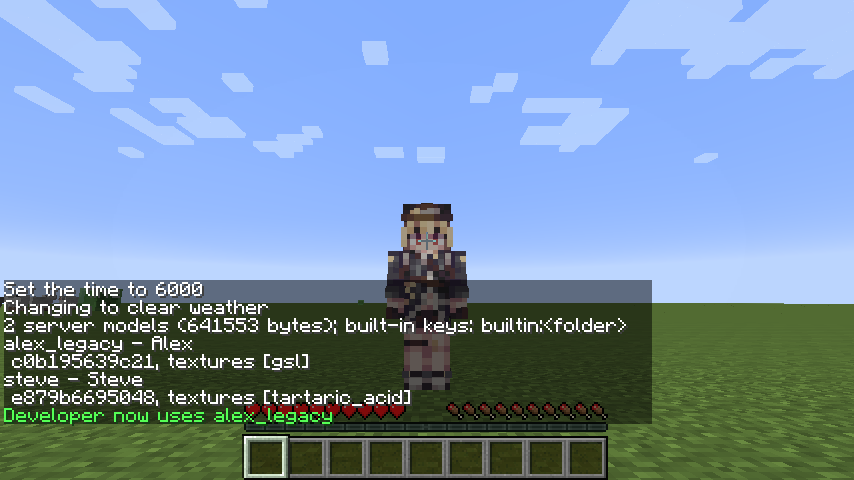

### Modelos `.ysm` legados: carregador nativo e leitura em memória

| Upstream | Aqui |
|---|---|
| `format/legacy/LegacyContainerHeader` (roteamento pelo cabeçalho) | `model/legacy/LegacyYsm.probe` |
| YesSteveModel-Native `modules/legacy/src/bundle.cc` (v1/v2, Crypto++ e zlib) | `model/legacy/LegacyBundle` (Java: MD5, AES-CBC, `Inflater`, `java.util.Random` do JDK) |
| `format/parser/LegacyManifestBuilder` (layout 1.x sem `ysm.json`) | `model/legacy/LegacyLayout` (escreve o `ysm.json` que o layout implica) |
| YesSteveModel-Native `modules/legacy/src/v3/{codec,container}` (envelope e contêiner v3) | `native/upstream/`, **sem mudança** |
| YesSteveModel-Native `modules/legacy/src/v3/container/image.cc` (recodifica imagens) | `native/src/legacy_image.cc` (só valida; os bytes ficam como vieram) |
| YesSteveModel-Native `modules/legacy/src/v3/conversion/projector.cc` (para o protobuf do upstream) | `native/src/exporter.cc` (para os arquivos do formato aberto) |
| YesSteveModel-Native `modules/lib-jni/src/legacy`, `natives/legacy/NativeLegacyImporter` | `native/src/jni_entry.cc`, `natives/LegacyNative` |
| `util/NativeLibUtil`, `gradle/native.gradle` | `natives/NativeLoader`, `native/build.sh` |
| `natives/legacy/LegacyFormalModelMapper` (para o modelo formal do upstream) | `model/legacy/LegacyArchive` (lê a exportação, RGBA → PNG) e o `ModelLoader` de sempre |

**Formatos.** Três famílias, separadas pelos primeiros bytes como no upstream:

* `YSGP` + versão 1 ou 2 (big endian): pacote cru do YSM 1.x/2.x antigo, uma lista dos arquivos do próprio modelo,
  cada um cifrado com AES-CBC e comprimido com zlib (na 2, a chave de cada arquivo vem cifrada com outra derivada do
  MD5 do arquivo por `java.util.Random`). Lido em Java puro, em qualquer plataforma; dentro há um modelo comum
  (`ysm.json` ou o layout 1.x).
* BOM UTF-8 + `YSGP`: o contêiner cifrado v3 (versões internas 1 a 32), o `.ysm` "exportado" do YSM 1.x/2.x. Só com a
  biblioteca nativa.
* Qualquer outra coisa é recusada com uma linha no log.

**Biblioteca nativa (`native/`).** O decodificador legado oficial do YesSteveModel-Native (Apache-2.0, commit
`907d1c6`), copiado sem mudança para `native/upstream/` (envelope: CityHash histórico, XChaCha com as mudanças de
parâmetro históricas, XOR de mt19937, zstd "sujo"; contêiner: o leitor de todas as versões). A biblioteca completa do
upstream (renderizador, codecs de imagem e áudio, Conan com 26 pacotes, MSVC no Windows) não vem: os cabeçalhos do
núcleo e dos codecs que o decodificador usa são trocados por `native/shim/` (detecção de SIMD, leitura dos cabeçalhos
de PNG/JPEG/WebP/AVIF e de Ogg), e as dependências são só abseil, zstd e libwebp (decodificador). O nosso código em
`native/src/`:

* `exporter.cc` faz o papel do `projector.cc` do upstream, mas para os arquivos do formato aberto, que o carregador de
  sempre lê: `ysm.json` spec 2 (metadados, propriedades, `extra_animation` com os oito padrões quando vazio, como o
  projector; `originVer` pela tabela de versões do upstream, `ModelOriginVersion.RELEASES`, porque o arquivo guarda o
  índice), geometria Bedrock, animações (ticks → segundos; o comprimento infinito, sentinela do importador antigo,
  fica ausente), controladores, texturas e PBR, avatares, imagens de GUI (`thumb-button`/`thumb-icon` →
  `thumbnail`/`icon`), sons, funções, idiomas, projéteis e veículos (`files.projectiles`/`vehicles`).
* **Geometria**: o contêiner legado guarda quads já assados (rotação do cubo aplicada, blocos, x negado: o
  `cubes_legacy` do upstream, os mesmos números do nosso `GeoBaker`). Vão como `poly_mesh` Bedrock por osso, em
  unidades Bedrock (pixels, x sem negar), UVs normalizadas medidas do topo (como as UVs de cubo), mais
  `futura3d_cube_faces` (quads por cubo) para o `GeoBaker` reagrupar os quads em cubos. Um cubo de seis faces com
  alguma normal para dentro é casca invertida, como `ProcessCube` do upstream (`SHAPE_NEGATIVE`). O teste confere que o
  quad volta idêntico ao gravado. O formato aberto do YSM não tem `poly_mesh`: é uma extensão nossa, só escrita pelo
  importador.
* Imagens: RGBA cru vai ao Java, que grava PNG; PNG e JPEG passam como estão; WebP é decodificado na biblioteca; AVIF
  recusa o modelo (textura) ou é pulado (avatar, GUI). O upstream recodifica tudo para o contêiner dele.
* `jni_entry.cc`: `LegacyNative.nConvert(byte[]) → byte[]` (o "F3DL": a lista dos arquivos) e `nAbiVersion()`. Erros
  viram `IOException` com a mensagem do decodificador.

Compilação cruzada com o Zig (um compilador para os dois alvos, `native/build.sh`): Linux x86_64 com glibc 2.17 ou
mais nova (servidor Crucible; a primeira tentativa com o gcc do Ubuntu 24.04 exigia glibc 2.38, nova demais para
Debian 12/Ubuntu 22.04) e Windows x64 (precisa do Universal C Runtime: Windows 10/11, ou 7/8.1 com a KB2999226). Só os
dois símbolos JNI são exportados. As bibliotecas vão no jar em `natives/<plataforma>/` com o `.sha256`;
`natives/THIRD_PARTY_LICENSES.txt` lista tudo o que foi ligado (o fork do CityHash e o ChaCha dentro do decodificador,
abseil, zstd, libwebp, o runtime C++ do Zig) com os textos de licença.

**`NativeLoader`.** Detecta a plataforma (`linux-x86_64`, `windows-x86_64`; outras não têm biblioteca), confere o
SHA-256 do recurso, copia uma vez para `<tmp>/futura3d-natives/libfutura3d-<hash>.so` (uma DLL carregada não pode ser
trocada no Windows: versão nova, arquivo novo; escrita atômica) e chama `System.load`. `-Dfutura3d.native.dir` muda a
pasta, `-Dfutura3d.native.path` carrega outra compilação. ABI conferida (`nAbiVersion`).

**Servidor.** `config/futura3d/models/<nome>.ysm` (e em `auth/`) entra como qualquer modelo: convertido em memória,
filtrado pelos tipos transferíveis, conferido pelos limites e pelo `ModelLoader`, com o nome do arquivo sem `.ysm`. A
entrada do catálogo leva **`memoryOnly`**: nada do modelo convertido é gravado em disco, nem no servidor nem no
cliente. Pastas e zips no layout 1.x (sem `ysm.json`) também passam a ser lidos.

**Protocolo 3.** A única mudança é o bit 4 nas flags do `S_MODEL` (`memoryOnly`). Um cliente 1 ou 2 recusaria a flag
desconhecida, então o servidor não oferece modelos `memoryOnly` a sessões abaixo da 3 (`Snapshot.offered`) e não manda
a elas os arquivos que só esses modelos têm (`Snapshot.content(hash, versão)`); um arquivo que um modelo aberto também
tem continua indo. O resto da negociação é a de antes (servidor 2 com cliente 3: hello de novo com 2).

**Cliente.** `ClientSession` guarda os arquivos usados só por modelos `memoryOnly` num `VolatileFileCache` da sessão,
nunca no `DiskFileCache`; a leitura (`files()`) procura na memória e depois no disco. Um catálogo novo sem o modelo
libera a memória (e, se ele voltar, os arquivos são baixados de novo); ao sair do servidor a sessão inteira é
descartada.

**Resultado.**

* Teste nativo (`native/test/native_test.cc`): o envelope contra o vetor congelado do upstream
  (`legacy_v3_dynamic_vector.ysm`: CityHash, XChaCha, mudanças de parâmetro, mt19937, sal, blocos zstd) devolve os
  12 004 bytes esperados; um modelo sintético v32 (gravado com o layout de fio do decodificador: osso com cubo, quadros
  -chave com `post` e Catmull-Rom, timeline, sons de quadro-chave, controlador com mistura linear e por segmentos,
  função, idioma, metadados, textura RGBA) sai com o JSON exato conferido campo a campo. A exportação dele é a
  fixture `src/test/resources/legacy/synthetic-v32.f3dl`.
* Testes Java: pacotes v1 e v2 escritos como o exportador antigo (o inverso do `bundle.cc`) com os arquivos do
  `misc/1_alex` voltam byte a byte e carregam; layout 1.x com `info.json`; a exportação sintética pelo `ModelLoader`
  (quad idêntico, pivô, rotação, animação em ticks, controlador, função, PNG do pixel RGBA, `originVer` →
  `FILE_HAND_LOOP`); a biblioteca de verdade por JNI no Linux (o vetor do upstream decifra e o contêiner aleatório é
  recusado com "Legacy container"; lixo é recusado com "Legacy envelope"); as duas bibliotecas extraem e batem com o
  `.sha256`; o repositório com `.ysm` v2 e v3 (decodificador simulado), `offered`/`content` por versão; o cliente
  guardando só na memória o que é só de modelo `memoryOnly`; a flag no codec.
* Servidor dedicado de verdade (`./gradlew runServer`, Forge, a biblioteca carregada pelo `LaunchClassLoader`):
  `Loaded alex_legacy.ysm: Alex (c0b195639c21, 11 files, 326123 bytes), memory only` (um `.ysm` v2 feito com o
  `misc/1_alex`; o id é o mesmo da pasta aberta, porque os arquivos são os mesmos) e `Skipped vector_v3.ysm: Legacy
  container: Historical collection exceeds its field limit` (o vetor do upstream: envelope decifrado pela biblioteca,
  conteúdo aleatório recusado).

* Servidor dedicado e cliente pela rede de verdade (harness `connect 127.0.0.1:25565 alex_legacy`, o servidor e o
  cliente do mesmo commit, Xvfb + llvmpipe, cache do cliente vazio): os dois modelos do catálogo prontos,
  `641553 bytes downloaded, 8 files held in memory only`; o cache em disco ficou com 11 arquivos, os do Steve (3 deles
  o Alex também usa, por isso foram para o disco, como deve). `/futura3d set` troca o jogador para
  `server:c0b195639c21...` e ele aparece com o modelo vindo do `.ysm`; o emote toca e para.

**A checar**:

* Um `.ysm` v3 **de verdade** (exportado pelo YSM 1.x/2.x): não há um redistribuível para testar aqui. O caminho
  inteiro foi coberto em duas metades (envelope com o vetor oficial, contêiner e exportação com o modelo sintético).
  Para conferir: pôr o arquivo em `config/futura3d/models/`, ver a linha `Loaded ... memory only` no log, escolher o
  modelo e comparar com o mesmo modelo no YSM 1.20 (poses, texturas, sons, controladores).
* A DLL no Windows de verdade (compilada e conferida por `objdump`, não executada) e o singleplayer lendo `.ysm` por
  ela; o servidor Crucible com Java 21 (testado com o servidor de dev, Java 8 e 21 têm o mesmo `System.load`).
* Clientes 2 (jar antigo) e 3 misturados no mesmo servidor com um modelo `memoryOnly` (testado com sessões reais pelo
  codec, não com jars de versões diferentes).
* Imagens AVIF (recusadas) e WebP animado; o tamanho em memória de modelos legados grandes (o servidor guarda os
  arquivos convertidos, como já guardava os abertos).
* Os scripts de geometria do 1.x (`ModelScript`: variáveis, `initialize`, `pre_animation`) e as flags de osso
  (`hidden`, `dont_render`...) ficam fora, como no projector do upstream.
